<div align="center">


# Hantang TCM · Ni Haixia Six-Meridian Pattern Differentiation · AI Diagnosis Assistant

**An offline-first, completely free app for learning TCM classical formulas and assisted diagnosis, faithfully recreating Ni Haixia's Renji lecture series system**

**🤖 Ask Master Ni AI (optional) | on-device lecture retrieval + your own model, so the lectures can answer back**

Offline-first · All data on-device · No sign-up · Ready out of the box (fully offline unless AI is enabled)

[简体中文](README.md) · [繁體中文](README.zh-Hant.md) · **English**

<a href="https://trendshift.io/repositories/108262?utm_source=trendshift-badge&amp;utm_medium=badge&amp;utm_campaign=badge-trendshift-108262" target="_blank" rel="noopener noreferrer"></a>
<a href="https://trendshift.io/repositories/108262?utm_source=trendshift-badge&amp;utm_medium=badge&amp;utm_campaign=badge-trendshift-108262" target="_blank" rel="noopener noreferrer"></a>

[](https://github.com/jangviktor-web/nihaixia-app/releases/latest)
[](https://flutter.dev)
[](https://dart.dev)
[]()
[](LICENSE)
[](https://github.com/jangviktor-web/nihaixia-app/stargazers)

<br/>

**[🤖 Ask Master Ni AI · Free API](#user-content-ask-nishi-ai)** · **[📥 Download APK](#-download-and-install)** · **[📖 Quick Start](#-quick-start)** · **[🏗️ Technical Architecture](#️-technical-architecture)** · **[🗺️ Roadmap](#️-roadmap)** · **[🤝 Contributing](#️-contributing)** · **[📄 Open Source License](#-open-source-license)**

</div>

---

## 📖 Project Overview

> "TCM is simple: it is just Yin and Yang, Qi and Blood. Once you understand that, everything falls into place." — Ni Haixia

**Hantang TCM** is a TCM classical-formula assistant built on the theoretical foundation of Ni Haixia's Renji lecture series (Shang Han Lun, Jin Gui Yao Lue, Huangdi Neijing, Zhenjiu Dacheng, Shennong Bencao Jing). It engineers the classical Six-Meridian pattern differentiation system to help you:

- **Evidence-based pattern differentiation**: Taking the Six Meridians as the framework and layering in Jin Gui Yao Lue pattern-family differentiation, guided intake automatically derives the pattern and the principal formula;
- **Instant lookup**: Formulas, materia medica, acupoints, acupuncture prescriptions, case records, and the classic texts are all bundled offline and searchable anytime, anywhere;
- **Traceable sources**: 1257 of Master Ni's case records are bidirectionally linked with formulas, so the pattern-differentiation reasoning can be traced back;
- **Broader literacy**: Huangdi Neijing knowledge cards and folk-culture tools such as Zi Wei Dou Shu, Yi Jing, and the Four Pillars build a complete view of traditional Chinese culture.

### Core Value Proposition

| Dimension | Description |
|:---|:---|
| 🔒 **Offline-first** | All knowledge bases are bundled into the app; it works without a network, and private data never leaves the device |
| 📚 **Faithful to the classics** | Strictly follows Master Ni's stance that "raw Fuzi and prepared Fuzi cannot substitute for each other"; Fuzi is split according to the system, with zero broken links in formula compositions |
| 🧠 **Engine-driven** | A custom Six-Meridian pattern differentiation state machine plus a dual-track differentiation tree reaches 322 formulas, with verifiable diagnostic logic |
| 🆓 **Completely free** | Apache 2.0 open-source license, no ads, no in-app purchases, no tracking |
| 🧪 **Guarded by tests** | Key pattern-differentiation paths and filtering logic all have regression tests; every fix ships with a test to prevent regressions |

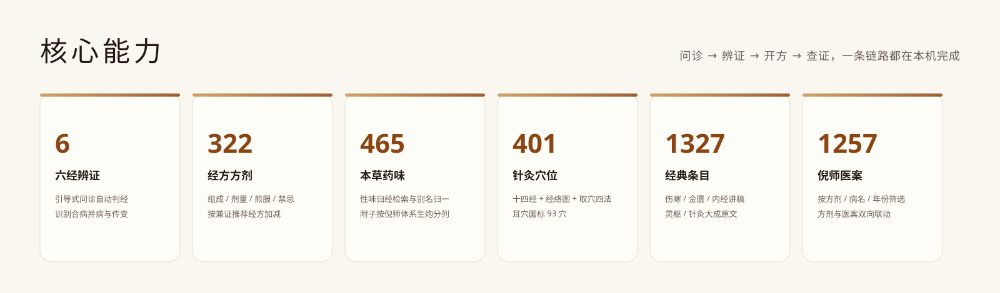

---

<a name="ask-nishi-ai"></a>

## 🤖 Ask Master Ni AI: your lecture library, your model

"Ask Master Ni AI" is the app's **only optional online feature**. It does not just
hand your question to a general-purpose chatbot. It **searches the on-device lecture
library first, then sends the matched passages together with their sources to the
model you configure yourself**. If the lectures do not cover something, it says so
instead of inventing an answer on Master Ni's behalf.

> [!TIP]
> **💰 Start for free: free APIs, ready in 5 minutes**
> The app ships no endpoint and charges nothing. Sign up for a free key from any
> OpenAI-compatible provider and fill it in at **Settings → AI Lecture Q&A**.
> **Start with Zhipu `GLM-4.7-Flash`**: direct connection in mainland China,
> free and fast, the best all-round choice for text Q&A. Endpoints, model names,
> caveats and field-by-field steps for all three providers: **[Free model configuration guide](docs/free_api_guide.md)**.

### How this differs from asking a general AI

| | General AI chat | Ask Master Ni AI |
|:---|:---|:---|
| Basis | The model's parametric memory, which easily mixes up classical formulas | Passages retrieved on-device: 394 Shang Han Lun clauses / Jin Gui / acupuncture / materia medica / 1257 case records / 48 disease-name pairs |
| Sources | Usually unavailable | Passages go into context with their sources; every referenced passage opens as original text |
| Drift control | Left to the model | Formula names absent from both passages and case records are flagged: "N formula names not found in the retrieved passages" |
| Endpoint | Fixed by the vendor | You supply any OpenAI-compatible endpoint; switching models means editing three fields |
| Network | Online by default | **Off by default**, zero network requests while off |

### What happens on a single question

1. **On-device retrieval**: three-tier priority — classical/modern and Chinese/Western disease names, formula names, then the raw keywords.
2. **Context assembly**: matched passages + sources + disease-name pairs + contraindications of related formulas are handed to the model.
3. **Structured answer**: "chief-sign table → pattern conclusion → formula reasoning", with a pinned disclaimer; formula, herb and acupoint names all open their detail pages.
4. **Source audit**: formula names in the answer are checked against the retrieved passages, and missing ones are listed so model-invented knowledge is not mistaken for Master Ni's words.

### What is included

- **Multiple sessions and resume**: conversations live in local SQLite and survive closing the page or killing the app; history is grouped by Today / Yesterday / Last 7 days / Older, with switch, rename and delete
- **Contraindications in context**: when a formula is identified, its cautions are supplied too, so it can answer "when should this formula *not* be used"
- **Disease-name mapping injected**: classical/modern and Chinese/Western equivalents enter context; the answer has an expandable list of matched pairs
- **Links inside answers**: formulas, herbs, acupoints and referenced passages all open their detail pages
- **One-tap model list**: settings can fetch the endpoint's model list, no typing model names
- **Any compatible endpoint**: OpenRouter, a local Ollama, or any other OpenAI-compatible service works too

### Three steps to enable

1. Pick one free provider from the [Free model configuration guide](docs/free_api_guide.md), sign up and create an API key
2. In **Settings → AI Lecture Q&A**, enter **base URL / API key / model name** (model list can be fetched)
3. Turn the switch on, go back to the knowledge base and tap "Ask Master Ni AI" in the top right

> [!IMPORTANT]
> **Privacy boundary**: this feature is **off by default** and the app makes no network
> requests while it is off. Once enabled, it connects only when you actively ask a
> question, sending the retrieved lecture passages plus your question — **no medical
> history and no diagnosis records are uploaded**; the API key stays in local SQLite.
> No pattern-differentiation result or formula suggestion can replace diagnosis and
> treatment by a licensed physician.

Full configuration: [⚙️ Detailed Configuration, section 2](#️-detailed-configuration).
Key signup paths, screenshots and common errors: [Free model configuration guide](docs/free_api_guide.md).

---

## 📷 Screenshots

<div align="center">

**v1.11.32 Ask Master Ni AI · Symptom self-check — local lecture retrieval + your own endpoint + one-page triage**

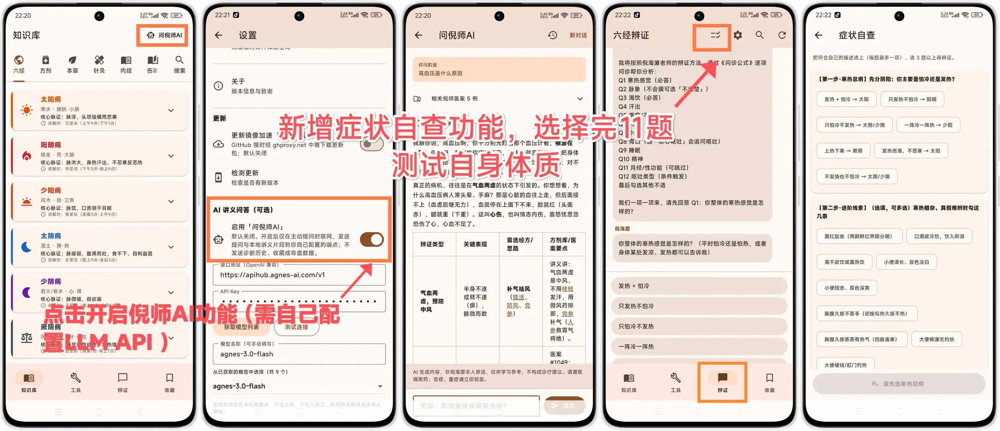

</div>

① **Knowledge base entry** — "Ask Master Ni AI" in the top-right corner; the button does not appear when the feature is off.

② **Settings → AI Lecture Q&A** — endpoint / API key / model name are all yours to fill in, and the switch is **off by default**; when off, the app makes no network requests at all.

③ **Answer view** — local lecture passages are fed to the model first, and answers follow "key symptoms table → pattern conclusion → formula reasoning", with a fixed disclaimer at the bottom; formula, herb and acupoint names in the answer are all tappable.

④ **Symptom self-check entry** — the checklist icon in the top-right of the "Diagnosis" tab.

⑤ **Symptom self-check** — cold/heat overview (required) → advanced clues (optional) → eleven questions; pick three items and the conclusion appears, and formulas remain tappable through to detail pages.

<details>
<summary><b>📁 Historical screenshots (v1.11.31 → v1.11.0, newest to oldest) · Click to expand</b></summary>

<div align="center">

**v1.11.31 Shang Han Lun module layout update · Full Song-edition Shang Han Lun ordering · Simplified/Traditional Chinese toggle**

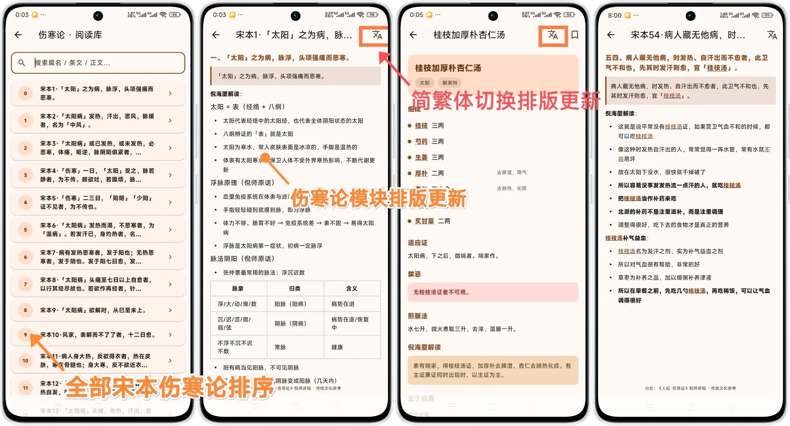

</div>

From left to right: ① **Shang Han Lun reading library** — all clauses are ordered by the Song edition 1–390, list names are unified as "Song edition N ·", and chapter names / clauses / main text are searchable. ② **Song edition 1 clause card** — the original-text block plus "Ni Haixia's Interpretation", with tables such as pulse-method Yin-Yang fully rendered and a Simplified/Traditional Chinese toggle in the top-right corner. ③ **Guizhi Jia Houpo Xingren Tang formula detail page** — composition / indications / contraindications / decoction and administration / Ni Haixia's Interpretation and a "Found in the Classics" group at the bottom, with Traditional Chinese display taking effect in sync. ④ **Song edition 54 clause card** — the original text and interpretation layout in Traditional Chinese mode.

<div align="center">

**v1.11.30 Full clause-card commentary coverage (839 cards) · Traditional Chinese display toggle · Traditional Chinese input searchable · Case records simplified**

</div>

- **100% clause-card commentary coverage**: all 839 clause cards (384 from Shang Han Lun + 433 from Jin Gui Yao Lue) now have commentary text (22 groups of "Question / Master says" Q&A cards merged; Jin Gui Yao Lue 455→433 clauses)
- **Traditional Chinese display**: a one-tap `translate` icon in the top-right corner of reading pages / herb detail pages / formula detail pages, with OpenCC dictionary-level conversion (干姜→乾薑, 郁金→鬱金); links remain clickable
- **Traditional Chinese input searchable**: searching "當歸" or "麻黃湯" no longer returns empty results (Simplified/Traditional normalization across all three search entry points)
- **Case-record library cleanup**: full-text Simplified Chinese conversion, 135 herb alias mappings, 94.1% prescription-herb parsing rate
- New herb "石菖蒲 (九节菖蒲)"; formulas 327→314 (a net merge of 13 groups of same-formula aliases)

**v1.11.29 Acupuncture lecture-transcript reading library (72 chapters) · Bidirectional lecture-transcript ⇄ acupoint linking** (Latest screenshots)

<div align="center">

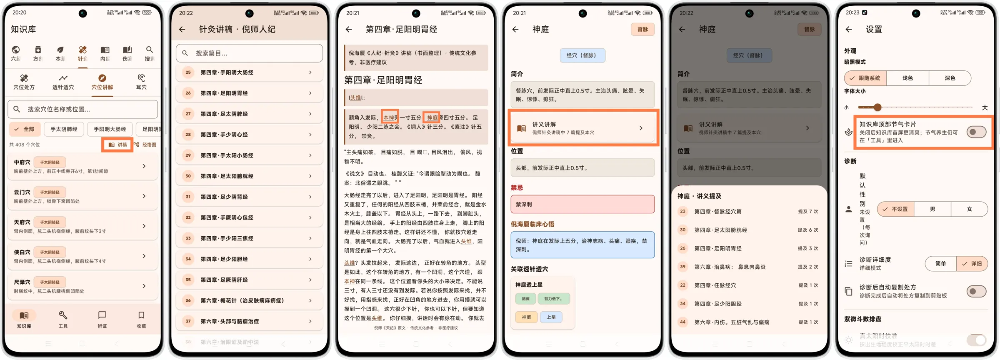

</div>

From left to right: ① **Acupuncture lecture-transcript entry** — the "Acupuncture" page in the knowledge base adds a "Lecture Transcripts" button alongside "Meridian Charts" in the acupoint filter row. ② **Acupuncture lecture transcripts · Chapter list** — the 72 chapters of the Renji lecture series · Acupuncture are arranged by section (when to use acupuncture / needling depth / the twelve regular meridians and the eight extraordinary vessels / needling techniques / the head-to-toe treatment series), with instant chapter-title search. ③ **Lecture transcript reading** — a written, edited layout where acupoint names (Touwei / Benshen / Shenting), formula names, and herb names in the text are automatically linked, one tap to the detail page. ④ **Acupoint detail · "Lecture Notes" card** — a new lecture card on the acupoint detail page shows how many transcript chapters mention this acupoint (e.g. Shenting is mentioned in 7 chapters) and hides itself when there are no hits. ⑤ **Shenting · Lecture mention list** — a bottom sheet lists the chapters sorted by mention count (Du Meridian acupoints chapter 7 times / Foot Taiyang Bladder Meridian 6 times / Treating nasal disease 2 times…), tap to jump to that chapter. ⑥ **Hideable solar-term card** — Settings → Appearance adds a "Solar-term card at the top of the knowledge base" switch; once off, the knowledge base home screen is cleaner, and solar-term wellness is still reachable from "Tools".

<div align="center">

**v1.11.27 Sanshan Guowang oracle slips · Xiao Liu Ren · Mei Hua Yi Shu · Save chart as image / share long image · Shake to cast a hexagram**

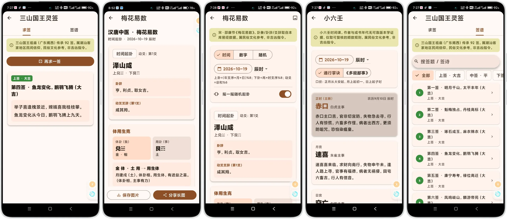

</div>

From left to right: ① **Sanshan Guowang oracle slips · Drawing a slip** — 92 slips handed down from the ancestral Sanshan Guowang temple in Jiexi, Guangdong; each slip has a number / title / original oracle poem / fortune grade; silently state your question, then shake to draw a slip, and you may draw again as often as you like. ② **Mei Hua Yi Shu · Chart result** — a random cast yields "Ze Shan Xian"; changing lines, the hexagram text, changing-line texts, and the Body/Use generation-restraint derivation are all visible on one screen; the AppBar image entry opens a long-image preview page with two exits, "Save image" (stored locally, **no storage permission needed**) and "Share long image" (opens the system share sheet, save to Photos / Files / WeChat). ③ **Mei Hua Yi Shu · Shake to cast** — the "Shake for random cast" switch in the input area is on by default; shaking the phone automatically switches to random casting and recasts a hexagram (without altering the entered time / numbers), confirmed by haptic feedback; one shake yields only one hexagram, and slow tilting is not mis-triggered. ④ **Xiao Liu Ren** — time-based divination: count forward through the month / day / hour palaces to settle on Da An / Liu Lian / Su Xi / Chi Kou / Xiao Ji / Kong Wang, with the six presiding spirits and their rhymes; since the art itself disagrees on "which palace the first day of the month falls in", **the "common palm formula" and the Duoneng Bishi are presented side by side as two conventions** for the user to choose, with the full calculation shown. ⑤ **Sanshan Guowang oracle slips · Slip index** — the full list of 92 slips, filterable by fortune (upper 42 / middle 31 / lower 17 / neutral 2) plus full-text search over titles and oracle poems; tap to pop up the complete slip text. All three modules carry a folk-culture reference Disclaimer and are clearly separated from the classical-formula medical modules; saved and shared long images also work on the Ba Zi chart / Zi Wei Dou Shu / Five Movements and Six Qi result pages.

<div align="center">

**v1.11.26 National-standard ear acupoint location charts · Fourteen-meridian circulation acupoint charts · Five Movements and Six Qi three-chart layout fix**

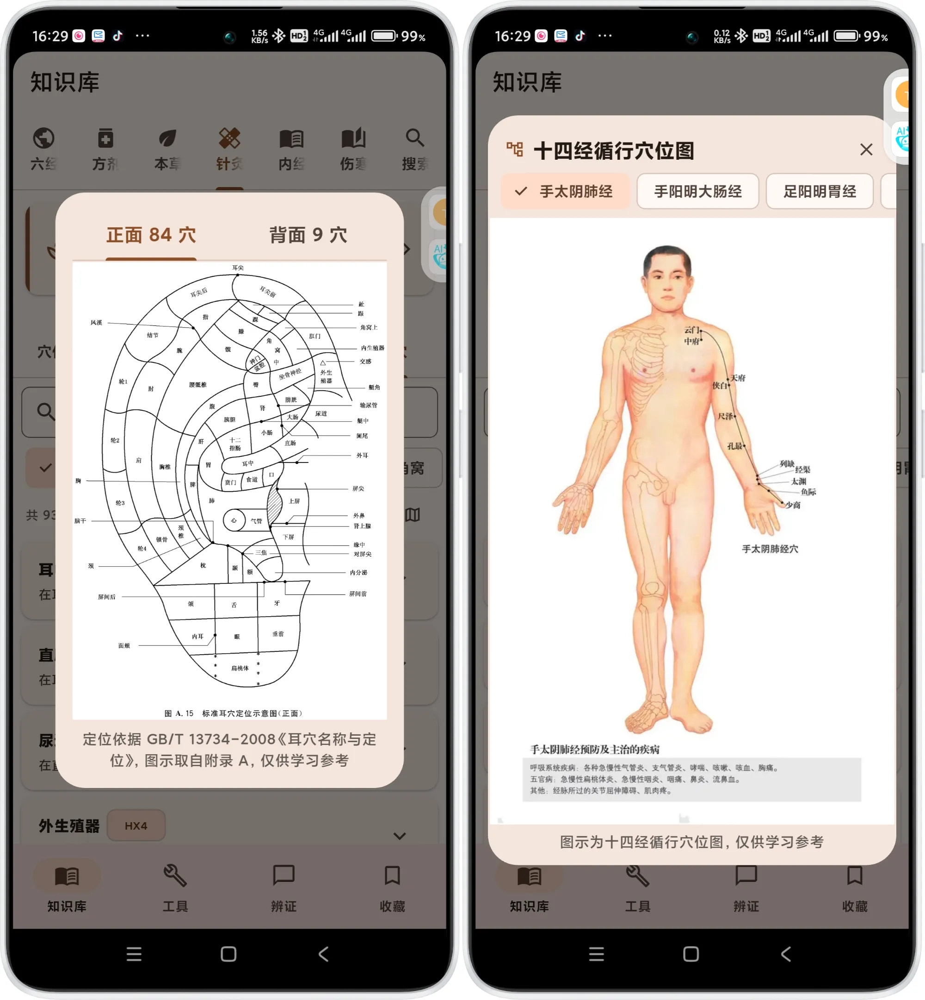

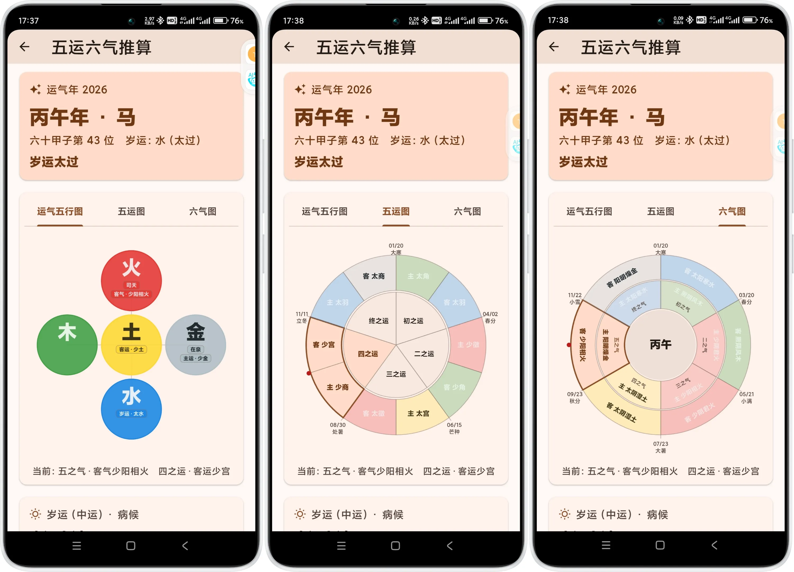

</div>

From left to right: ① **National-standard ear acupoint location charts** — the ear map embeds the Annex A standard chart of GB/T 13734-2008 "Nomenclature and Location of Auricular Points", with two tabs "front 84 points / back 9 points", pinch to zoom in on point names, and an on-page note "For study reference only"; the companion "Ear Acupoints" library holds 93 points filterable by national-standard zones (HX/SF/AH/CO…), searchable by point name / pinyin / code. ② **Fourteen-meridian circulation acupoint charts** — the acupoint guide adds a "Meridian Charts" entry with 14 circulation charts for the twelve regular meridians plus the Ren and Du vessels; meridian pathways, their acupoints, and each meridian's "diseases prevented and treated" are all visible in one chart, with 6× pinch zoom to read point names. ③–⑤ **Five Movements and Six Qi three-chart layout fix** — in the **Yun Qi Five Elements chart** the five palaces' radii and spacing are rebalanced so badges no longer overlap the text; the **Five Movements chart** colors the host and guest movements separately with clear step-boundary dates; in the **Six Qi chart** the three text layers "outer ring guest Qi / inner ring host Qi / step name" are laid out along the sector tangents so the 3 o'clock and 9 o'clock directions no longer collide; pick any date and all three charts redraw instantly with the current step highlighted (shown for the 2026 Bingwu year).

<div align="center">

**v1.11.25 Yi Jing 64-hexagram illustrations · Four TCM time-based acupoint-opening methods · Five Movements and Six Qi three charts**

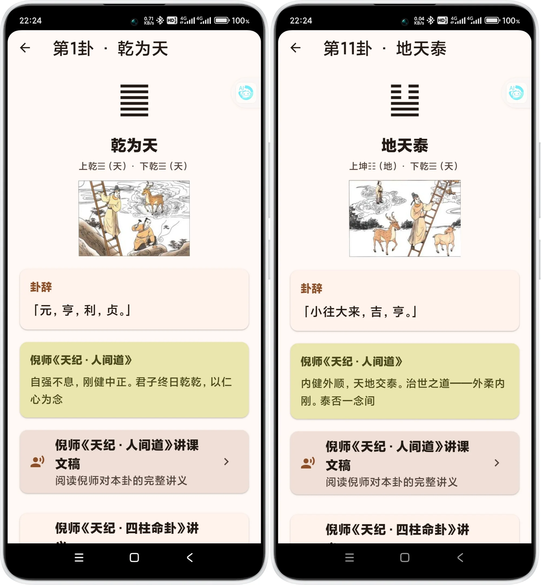

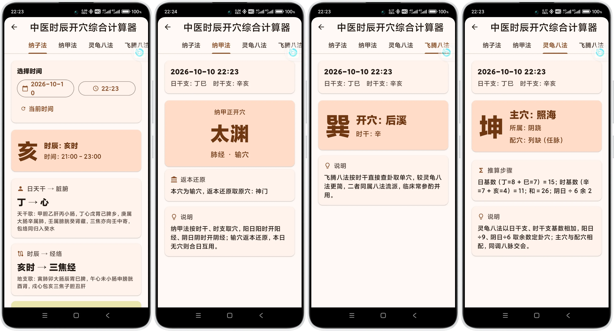

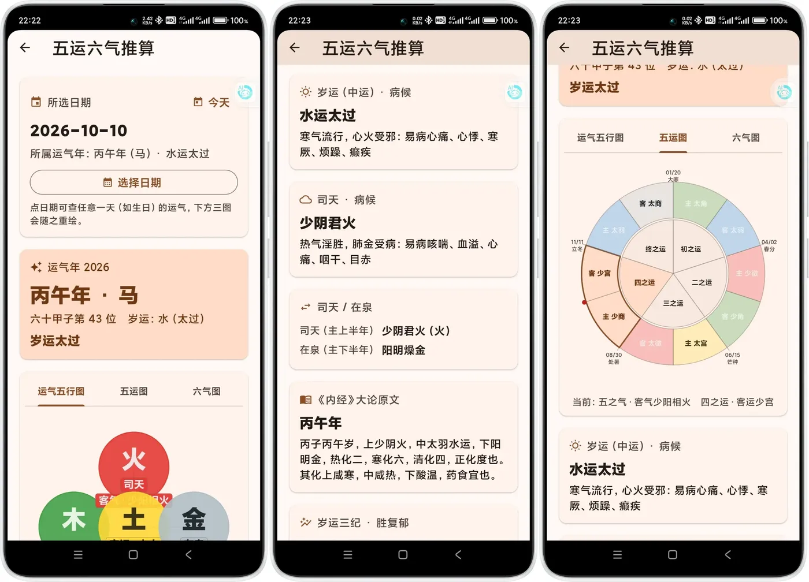

</div>

From left to right: ① **Yi Jing 64-hexagram illustrations** — below the hexagram name on each detail page is a traditional allegorical woodcut for that hexagram (Qian as Heaven = taking a deer from the clouds, Earth over Heaven Tai = taking a deer on a ladder); all 64 hexagrams are covered and mapped one-to-one to the hexagram-name data, and a missing image is silently hidden without affecting the page. ② **TCM time-based acupoint-opening calculator · Four methods side by side** — four tabs for Na Zi Fa / Na Jia Fa / Ling Gui Ba Fa / Fei Teng Ba Fa; tap or press "Current time" to instantly get the day and hour stems-branches and see the open acupoints (Na Jia main opening · Taiyuan "Lung Meridian · Shu point", Fei Teng Ba Fa · Houxi, Ling Gui Ba Fa · Zhaohai paired with Lieque), plus "Return to the source" for reverting to the Yuan point, stem-branch → organ/meridian correspondence rhymes, calculation steps and notes. ③ **Five Movements and Six Qi three charts** — the **Yun Qi Five Elements chart** (a cross of five palaces around the center, with Si Tian / Zai Quan linked to the five-element circle), the **Five Movements chart** (a single ring of ten sectors, host and guest movements color-coded with step-boundary dates marked), and the **Six Qi chart** (double ring); pick any day (e.g. a birthday) and all three redraw with the current step highlighted, while below are given the year-movement (central movement) disease signs, Si Tian / Zai Quan, guest-Qi superimposition, and the original text of the Neijing great treatises.

<div align="center">

**v1.11.24 Six extraordinary-meridian groups added to acupoint filtering · National-standard acupoint order**


</div>

The meridian filter in the acupoint guide grows from 15 groups to **21 groups**: beyond the twelve regular meridians plus Du and Ren, six extraordinary-meridian groups are added — **Chong Mai / Dai Mai / Yin Wei Mai / Yang Wei Mai / Yin Qiao Mai / Yang Qiao Mai**; 57 crossing points now carry their meridian labels, and multi-meridian points faithfully appear in every group they belong to (e.g. Gongsun appears in both "Spleen Meridian" and "Chong Mai"), so searching "Chong Mai" directly hits its crossing points. Also shipped in this version: national-standard acupoint ordering within the twelve regular meridians / Du and Ren groups, a secondary-key fix for same-named parallel points, and link suppression for "Uterus" in anatomical contexts.

<div align="center">

**v1.11.23 Shang Han Lun / Jin Gui Yao Lue clause-level reading library · Bidirectional formula ⇄ clause linking**

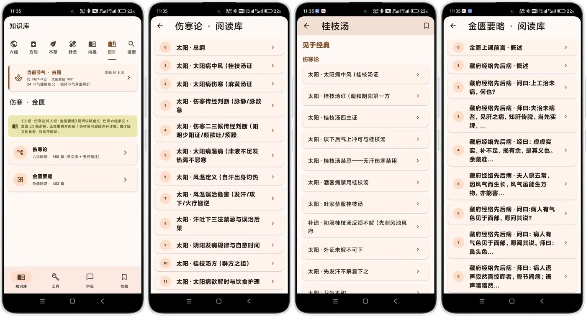

</div>

From left to right: ① **New "Shang Han Lun / Jin Gui Yao Lue" tab in the knowledge base** — two entries: 380 Shang Han Lun chapters (clause level + five-meridian overviews) and 453 Jin Gui Yao Lue chapters. ② **Shang Han Lun · Reading library** — 23 major modules broken down to clause level and listed one by one (Taiyang · General Principles / Taiyang disease with wind stroke (Guizhi Tang pattern) / Taiyang disease with cold damage (Mahuang Tang pattern) / judging Taiyang disease transmission …). ③ **"Found in the Classics" on formulas** — taking Guizhi Tang as an example, clauses **specifically introducing that formula** are listed in two groups, "Shang Han Lun / Jin Gui Yao Lue"; tap to jump to the original text. ④ **Jin Gui Yao Lue · Reading library** — 25 miscellaneous-disease chapters arranged by clause (Zang-Fu meridian sequence of diseases, convulsive / dampness / summerheat diseases, malaria …). Formula names and herb names in the text jump to their detail pages with one tap — the first **bidirectional linking** between classical-formula texts and formulas · herbs.

<div align="center">

**v1.11.19 Neijing structured entry search · Solar-term wellness**

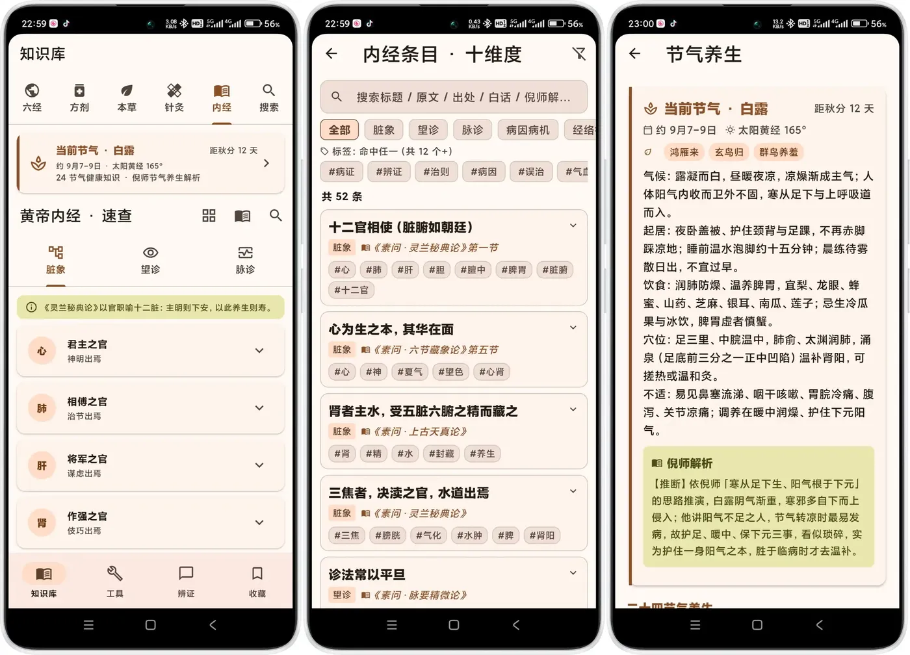

</div>

From left to right: ① **Knowledge base home** — six entries at the top, "Six Meridians / Formulas / Materia Medica / Acupuncture / Neijing / Search"; the "Current solar term" card directly shows the solar-term name, days until the next solar term, solar longitude, and the three pentads, with the "Huangdi Neijing · Quick Reference" entries for Zang-Xiang / inspection / pulse diagnosis listed below. ② **Neijing entries · Ten dimensions** — 52 structured entries searchable across 10 dimensions (Zang-Xiang / inspection / pulse diagnosis / etiology and pathogenesis / meridian circulation / Qi, Blood and Body Fluids / pattern-differentiation system / treatment principles and formulas / disease examples / erroneous treatment do's and don'ts), with six-field search (title / original text / source / vernacular / Master Ni's interpretation), chapter-title search, and cross-filtering by tags; each card explicitly marks its chapter source (e.g. Su Wen · Ling Lan Mi Dian Lun, section one). ③ **Solar-term wellness detail** — each of the 24 solar terms gives five kinds of wellness tips (climate / daily routine / diet / acupoints / discomforts), plus a "Master Ni's Analysis" card; anything not a direct quote from the original is uniformly marked [Inferred], so "classic original vs interpretation" is clear at a glance.

<div align="center">

**v1.11.17 Zhou Gong dream interpretation · Childhood Guan Sha · Zi Wei early/late Zi hour correction**

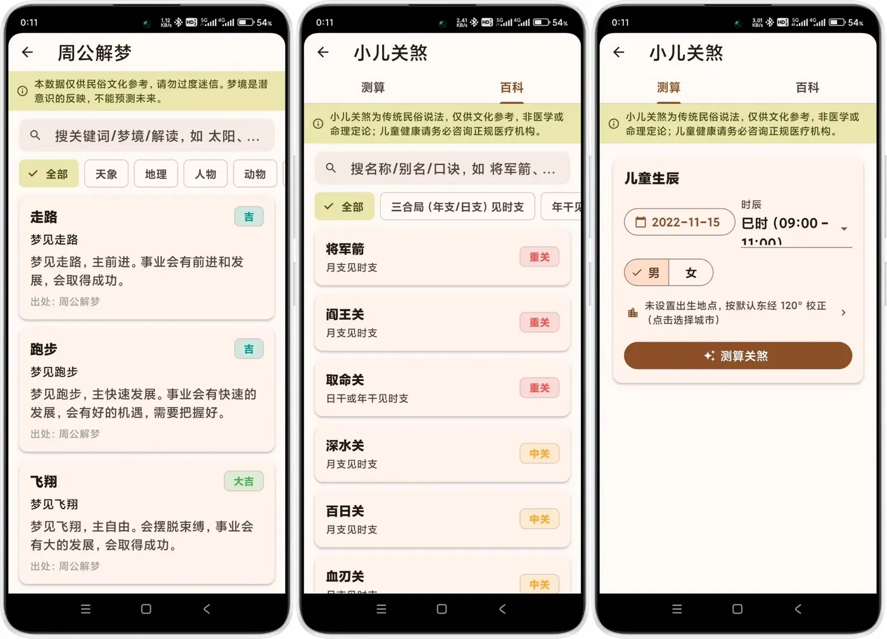

</div>

Added the "Zhou Gong Dream Interpretation" module (412 folk dream interpretations, keyword/category search, fortune annotations); added the "Childhood Guan Sha" module (36 guan + 18 extended sha, with calculation and encyclopedic search, plus a folk-culture reference Disclaimer); the Zi Wei chart's early/late Zi hour correction was refactored, with the original birth time read-only and the lunar-calendar display following the corrected stems-branches.

<div align="center">

**v1.11.13 Daily Chinese almanac · Zodiac clash / Yu Xia Ji deity festivals + Chaoshan folk customs / Yu Xia Ling Zhao module**

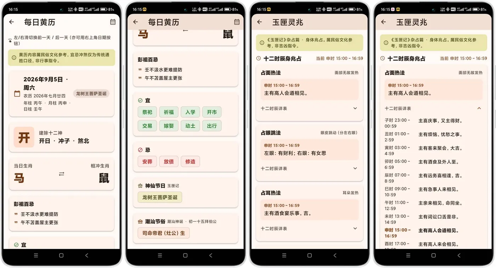

</div>

From left to right: ① **Daily Chinese almanac · Zodiac clash** — the day's clashing zodiac sign is derived from the day's earthly branch via the six clashes (e.g. a Zi day clashes with Horse), clear at a glance. ② **Daily Chinese almanac · Yu Xia Ji deity festivals + Chaoshan folk customs** — Yu Xia Ji collects the Three Yuan and Five La birthdays of deities (114 entries), the Ten Yama Kings (10 entries), and fast days, 125 lunar-calendar days in total; Chaoshan local entries are listed separately (e.g. "Si Ming Di Jun", "Zao Gong Sheng") and are de-duplicated at runtime against existing traditional festivals without overriding them. ③ **Yu Xia Ling Zhao · Face-heat divination** and ④ **Yu Xia Ling Zhao · Eyelid-twitch divination** — body-omen divination from Yu Xia Ji, with a reading for each of the twelve double-hours, the current double-hour highlighted automatically, and an expandable twelve-double-hour table (left eye twitching means money, right eye means a woman thinking of you, etc.); a new entry is added on the Tools page, with a folk-culture reference Disclaimer.

<div align="center">

**Master Ni's case-record library · Closed-door course severe-case clinical records · Six-Yao coin casting · Practical tools**

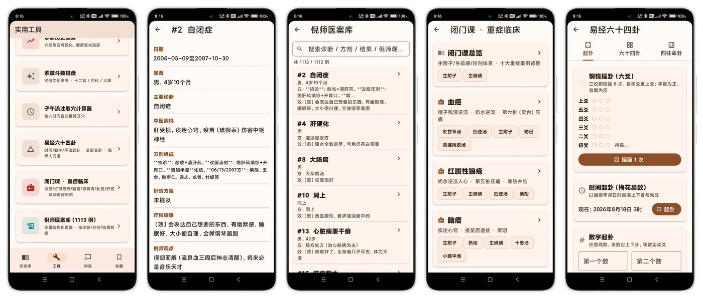

**Huangdi Neijing: Zang-Xiang · Inspection · Pulse Diagnosis · 73-chapter reading library**

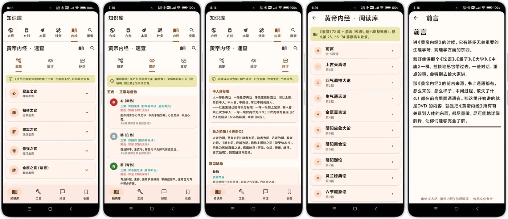

**Guided intake · Six-Meridian quick reference · Formula quick reference**

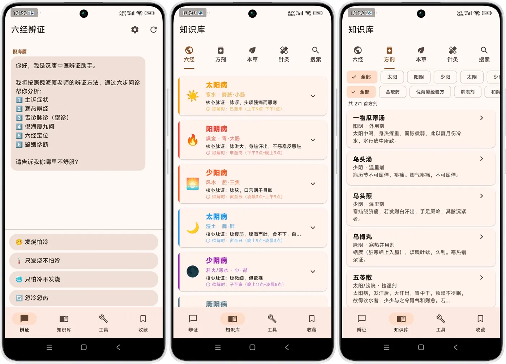

**Materia medica quick reference · Acupuncture acupoints · Practical tools**

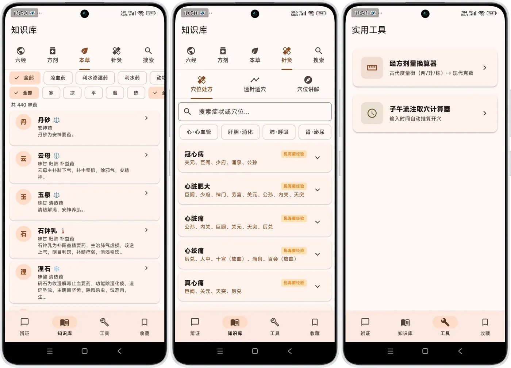

**Four Pillars Ming Gua · Zi Wei Dou Shu chart · Yi Jing sixty-four hexagrams**

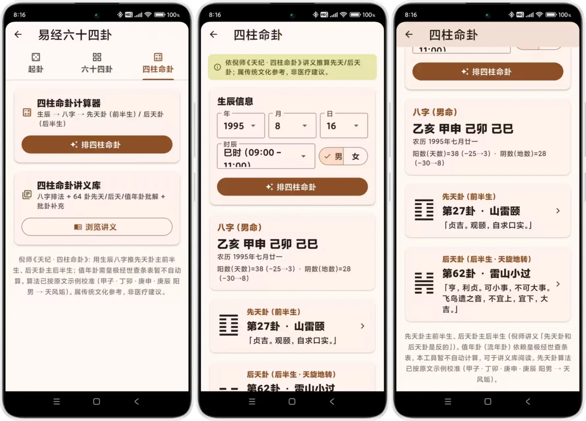
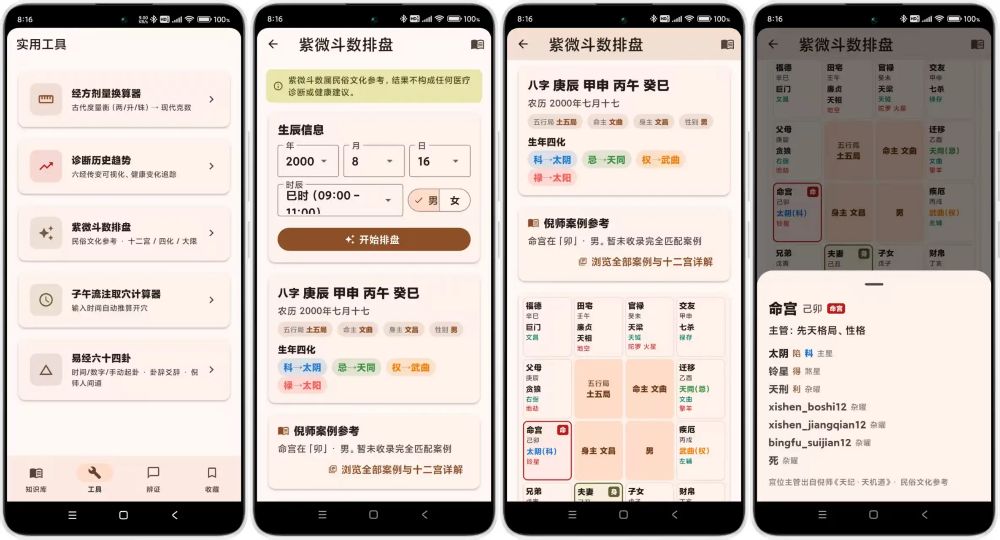
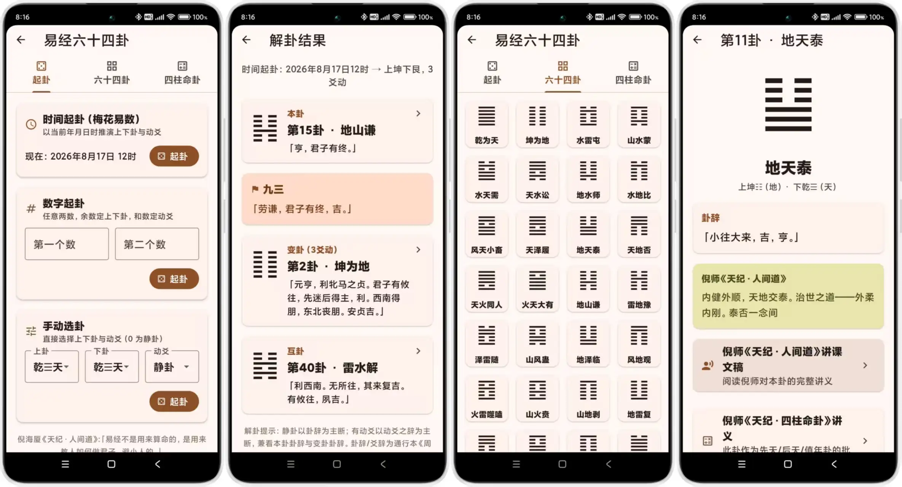

**Master Ni's closed-door course content · Master Ni's selected case records**


**Added the daily Chinese almanac and solar-term wellness modules ·  Improved the Zi Wei Dou Shu chart's major-luck and annual/monthly detailed readings and the automatic place-name matching for the "True Solar Time" selection**


</div>

</details>

---

## ✨ Core Features and Highlights

| Feature | Description | Data Scale |
|:---|:---|:---:|
| 🩺 **Six-Meridian pattern differentiation diagnosis** | Smart guided intake automatically determines Taiyang / Yangming / Shaoyang / Taiyin / Shaoyin / Jueyin and supports combined and concurrent diseases | 6 meridians |
| 💬 **Patient colloquial profiles** | The result page shows "What the patient would say" — plain-language chief complaint + differentiation indicators + treatment + original clause, checkable line by line; it also lets modern symptom words like "aversion to cold / aversion to wind" recall classical formulas (enhancement cap < 1, so the original correct ordering is never disrupted) | 170 formulas |
| 📋 **Complete prescription generation** | Automatically shows composition, dosage, decoction and administration, and contraindications, and recommends classical-formula modifications | 23 rules |
| 🔍 **Differential diagnosis** | Automatically compares the key differences between similar patterns to support precise pattern differentiation | 26 pairs |
| 📚 **Formula quick reference** | Search + Six-Meridian filter + category filter, available offline | 322 formulas |
| 🌿 **Herb quick reference** | Search + three filters (category / nature and flavor / meridian tropism), covering the full Shennong Bencao Jing; Fuzi is split into raw and prepared entries per Master Ni's system | 465 herbs |
| 📍 **Acupuncture acupoint quick reference** | The fourteen meridians + extraordinary points, with location / needling / moxibustion / contraindications / clinical insights, and bidirectional acupoint ⇄ prescription links | 408 acupoints |
| 💉 **Acupoint prescriptions · Through-needling** | 14 categories of acupuncture prescriptions (257 entries) + 31 through-needling point pairs; component acupoints are tappable | 14 categories |
| ⏰ **Zi Wu Liu Zhu acupoint selection** | Enter a time to automatically compute the open acupoint | 361 acupoints |
| 🔧 **Classical-formula dosage conversion** | Ancient units (liang / sheng / zhu) → modern grams | — |
| 📖 **Huangdi Neijing** | 12 Zang-Xiang cards + inspection (five colors / eye diagnosis) + pulse diagnosis (healthy / fatal pulses) + a 73-chapter reading library + full-text search; new "structured entry search" with 52 entries / 10 dimensions, four separated fields (original text · source · vernacular · Master Ni's interpretation), six-field search + dimension + tag cross-filtering | 73 chapters + 52 entries |
| 📜 **Shang Han Lun · Jin Gui Yao Lue clause library** | 394 Shang Han Lun chapters (390 clauses + 4 appendices) + 433 Jin Gui Yao Lue chapters broken down to clause level for clause-by-clause reading; formula / herb names in the text jump to detail pages in one tap, and "Found in the Classics" on formula detail pages marks the source clauses in reverse | 827 clauses |
| 📜 **Original classic texts** | 82 chapters of the Ling Shu + 339 chapters of the Ming-dynasty Zhenjiu Dacheng, with a searchable chapter table of contents, tappable formula / herb names, and a "Classics" group in global search that spans lecture transcripts and original texts | 421 chapters |
| 📚 **Master Ni's case-record library** | 1257 searchable cases + a closed-door-course severe-case clinical module, with bidirectional case-record ↔ formula links | 1257 cases |
| 🎲 **Six-Yao coin casting** | Cast three coins line by line; multiple changing lines automatically produce the transformed hexagram | Folk reference |
| 📜 **Yi Jing sixty-four hexagrams** | Cast by time / numbers / manual selection; interprets the primary hexagram · changing lines · transformed hexagram · interlocking hexagram, with the Ren Jian Dao 64-hexagram lecture transcripts integrated | 64 hexagrams |
| ☯️ **Four Pillars Ming Gua** | Innate / acquired hexagram calculation (Heaven-Earth number method), with Master Ni's Four Pillars Ming Gua lecture library | 64 hexagrams |
| 🔮 **Zi Wei Dou Shu chart** | Visualizes the twelve palaces / major stars / four transformations / major-luck periods / annual charts, with all minor stars in Chinese, and supports True Solar Time + longitude; after casting, it generates an overall fortune / ten-year major luck / annual summary and gives health reminders from the annual Illness Palace (folk-culture reference) | 115 stars |
| 📊 **Ba Zi detailed reading** | Shen Sha / structure / Day Master strength / five-element distribution / favorable and unfavorable gods, one-tap detailed reading | Folk reference |
| 💾 **My Chart Library** | Zi Wei Dou Shu chart results can be named and saved, with list management, swipe-left to delete, and tap to review (birth data and city are refilled for recasting), avoiding repeated input | — |
| 🍂 **Solar-term wellness section** | A standalone 24-solar-term section, each with health and wellness tips + Master Ni's solar-term analysis (non-original text marked [Inferred]), decoupled from the materia medica library | 24 solar terms |
| 👆 **Daily Chinese almanac gestures** | Swipe up/down to change day and left/right to change month for easy one-handed browsing, with the date picker kept as a fallback | — |
| 🔁 **Opposite-palace major-luck analysis** | When a major-luck palace is empty, major / malefic star hints from the opposite palace are attached automatically, visualizing the Zi Wei "borrowing stars to fill a palace" convention | — |
| 🔔 **In-app updates** | One-tap check for new GitHub releases in Settings, with download and install support | — |
| ⚙️ **Diagnosis settings** | Default gender / diagnosis detail level / auto-copy prescription, for a personalized intake experience | 3 items |
| 💾 **Data management** | Clear history / export favorites / clear cache, full control over local data | — |
| 🤖 **[Ask Master Ni AI (optional)](#user-content-ask-nishi-ai)** | Retrieves from the local lecture library first (Shang Han Lun / Jin Gui / acupuncture / materia medica / cases / disease-name pairs) and hands the matched passages plus their sources to the model; endpoint and key are yours, **off by default** with zero network traffic when off; formulas, herbs and acupoints in answers are tappable, and every referenced passage opens as original text | 394 lectures |
| 📝 **Symptom self-check** | One-page triage in the Diagnosis tab: cold/heat overview (required) → advanced clues (optional) → eleven questions; three selections produce a conclusion with six-meridian assignment, pattern, confidence and matched symptoms, and formulas remain tappable; says so directly when all six health baselines are met | 11 questions |

> **Special note**: The Zi Wei Dou Shu, Yi Jing, Four Pillars, and Six-Yao modules are **traditional Chinese folk-culture references**, not for medical diagnosis, and are clearly separated from the classical-formula medical modules in both UI and wording.

---

## 📱 Download and Install

> **Hantang TCM nihaixia‑app**
> Core features fully offline ｜ No sign-up ｜ Android 7.0+
> "Ask Master Ni AI" is **optional**: you supply the endpoint and key yourself, it is **off by default**, and when off the app makes no network requests (see [PRIVACY.md](PRIVACY.md))
> Universal APK about 82MB, per-architecture builds 34–38MB
> Since V1.11.9, builds and releases are automated by GitHub Actions; pushing a `v*` tag produces the packages
> **Last updated: 2026-11-07 (v1.11.32)**

> [!TIP]
> **💰 Free API · enable "Ask Master Ni AI" in 5 minutes**
> Zhipu, InternLM and Agnes all offer free models — pick one and pay nothing.
> Recommended order and field-by-field steps: **[Free model configuration guide](docs/free_api_guide.md)**.
> How it works and its privacy boundary: **[🤖 Ask Master Ni AI](#user-content-ask-nishi-ai)**.

### 📥 Method 1: Download Prebuilt APK (V1.11.32)

[](https://ghproxy.net/https://github.com/jangviktor-web/nihaixia-app/releases/download/v1.11.32/app-release.apk)
&nbsp;&nbsp;
[](https://ghproxy.net/https://github.com/jangviktor-web/nihaixia-app/releases/download/v1.11.32/app-arm64-v8a-release.apk)
&nbsp;&nbsp;
[](https://ghproxy.net/https://github.com/jangviktor-web/nihaixia-app/releases/download/v1.11.32/app-armeabi-v7a-release.apk)
&nbsp;&nbsp;
[](https://ghproxy.net/https://github.com/jangviktor-web/nihaixia-app/releases/download/v1.11.32/app-x86_64-release.apk)

| Package | Size | Recommended for |
|---|---|---|
| Universal `app-release.apk` | 85.1MB | All CPU architectures; the right choice for most Android devices |
| arm64‑v8a `app‑arm64‑v8a‑release.apk` | 38.0MB | Newer 64-bit Android phones, smaller size |
| armeabi‑v7a `app‑armeabi‑v7a‑release.apk` | 35.7MB | Older 32-bit Android devices |
| x86_64 `app‑x86_64‑release.apk` | 39.6MB | Android virtual machines and emulators |

> **V1.11.32 Ask Master Ni AI (local lecture retrieval + bring-your-own endpoint) · Symptom self-check · In-answer linking · Formula contraindications in context**
>
> 
>
> **1. Ask Master Ni AI**: a question is first retrieved against the offline lecture library (394 Shang Han Lun clauses / Jin Gui / 72 acupuncture lectures / 335 materia-medica lectures / 1,257 case records / 48 ancient-modern disease-name pairs / 408 acupoints / 314 formulas). The matched original passages are fed to the model **together with their sources**, and the persona hard-constrains it to answer only from those passages — if the lectures do not cover something it must say so, rather than invent clause numbers or formulas. **The endpoint is yours** (OpenAI-compatible base URL / API key / model name, with one-tap model listing) and is **off by default**; when off, the app makes no network requests, and the key is stored only in the local SQLite database. Conversations persist locally (DB v6) and survive leaving the page or killing the app; a session drawer groups history into today / yesterday / last 7 days / earlier, with switch, rename and delete. Any formula mentioned in an answer that appears in neither the passages nor the case records is flagged as "N formula names not found in the lecture passages". Contraindications and key points for all 314 formulas are also placed in context, so the model can answer "when must this formula NOT be used".
>
> **2. Symptom self-check**: the "Diagnosis" tab gains a one-page triage — cold/heat overview (required) → advanced clues (optional, multi-select) → eleven questions; three selections are enough for a conclusion. Results show the six-meridian assignment, pattern, confidence, matched symptoms and reasoning, with formulas tappable through to detail pages. If all six of Master Ni's health baselines are met, it says so directly instead of forcing a formula. Positioned as fast triage; for complex presentations the chat-style interview is still recommended.
>
> **3. In-answer linking**: formula, herb and acupoint names in answers automatically become tappable links to their detail pages (longest-match first, formulas take precedence, acupoints carry an exclusion list so short names like "Taiyang" or "Guangming" are not mis-linked). Every entry under "N local lecture passages referenced" can be opened as the original text, so you can check whether the answer actually follows the lectures.
>
> **4. Fixes and engineering**: fixed a name collision between the extra "Xiaoke" acupoint and the disease name "Xiaoke", which made "how to differentiate Xiaoke" be misrouted as an acupuncture query and pushed the Jueyin chapter out of context; fixed a title-mark split in the "Found in the Classics" index (Song 175 Gancao Fuzi Tang was missed and Fuzi Tang mis-linked, with Song 177 and 112 corrected as well); added regression tests (symptom→formula reachability 7/8, link injection 5, session persistence 3, source audit 3, formula contraindications 5); full `flutter test` 868 passed / 2 failed (both pre-existing baseline failures).
>
> See [Release Notes](release_notes/v1.11.32.md).
>

<details>
<summary><b>Historical changelog (v1.11.31 and earlier)</b></summary>

> **V1.11.31 Unified Song-edition Shang Han Lun · Fixed "Found in the Classics" on formulas · Standardized layout**: Shang Han Lun assets were switched wholesale to Song-edition clause numbering (390 clauses + 4 appendices = 394 chapters), with list names unified as "Song edition N ·"; the classics index (1728 entries) and formula index (279 entries) were rebuilt and aligned; "Found in the Classics" jumps were completed for 8 formulas and the mistaken "Xingzi Tang" link was removed; clause-card layout was standardized and R1 was cleared. See [Release Notes](release_notes/v1.11.31.md).
> 
> **V1.11.30 Full clause-card commentary coverage · Traditional Chinese display · Case records simplified**: all 839 clause cards (384 from Shang Han Lun + 433 from Jin Gui Yao Lue) now have commentary (22 groups of Q&A cards merged); Traditional Chinese display toggles added to reading pages / herb detail pages / formula detail pages (OpenCC dictionary-level); all three search entries accept Traditional Chinese input; case records fully converted to Simplified Chinese + 135 herb alias mappings. See [Release Notes](release_notes/v1.11.30.md).
> 
> **V1.11.28 Font size 200% · Original classic texts (Ling Shu / Zhenjiu Dacheng) · Classics full-text search · Smoothness improvements**: the font-size cap was raised from 150% to 200%, and the "only the home page follows the font size" bug was fixed — detail pages, Settings, and dialogs now follow it too; a new "Original Classic Texts" library was added: 82 chapters of the Ling Shu + 339 chapters of Yang Jizhou's Ming-dynasty Zhenjiu Dacheng, with a readable, searchable table of contents and tappable formula / herb names in the text; global search gains a "Classics" group spanning Shang Han Lun / Jin Gui Yao Lue / Neijing lecture transcripts and original classic texts, 1327 entries in total, tap to jump to a chapter; fixed the contrast problem where search-result titles were nearly invisible in light mode; knowledge-base tab switching and long-list scrolling got keep-alive and filter-cache optimizations. See [Release Notes](release_notes/v1.11.28.md).
> 
> **V1.11.26 Fourteen-meridian circulation acupoint charts · National-standard ear acupoint library · Five Movements and Six Qi three-chart layout fix**: the acupuncture page adds "Meridian Charts" — 14 circulation acupoint charts for the twelve regular meridians plus the Ren and Du vessels, with 6× pinch zoom to read point names; ear acupoints are fully integrated with GB/T 13734-2008 "Nomenclature and Location of Auricular Points" — a 93-point national-standard library (10 zone filters + point-name / pinyin / code search, 18 old names automatically merged into national-standard names) and the Annex A standard location chart (front 84 points / back 9 points) bundled directly; acupuncture prescription data expanded to 384 entries (merging Master Ni's BBXX disease point pairings, +127 entries); the Five Movements and Six Qi three-chart layout was fixed (the Six Qi chart's three text layers now run along tangents without overlap, and the Five Elements chart's palace circles were rebalanced) plus a 7-year engine classics-arbitration correction. See [Release Notes](release_notes/v1.11.26.md).
> 
> **V1.11.25 Yi Jing 64-hexagram illustrations · Four TCM time-based acupoint-opening methods · Five Movements and Six Qi three charts**: each Yi Jing hexagram detail page adds a traditional allegorical illustration (all 64 hexagrams, one-to-one with hexagram names, silently hidden if missing); the "TCM time-based acupoint-opening calculator" shows four methods side by side (Na Zi Fa / Na Jia Fa / Ling Gui Ba Fa / Fei Teng Ba Fa), instantly giving the day and hour stems-branches and open acupoints, with return-to-source and calculation steps; three new Five Movements and Six Qi visualizations (Yun Qi Five Elements chart / Five Movements chart / Six Qi chart) redraw for any chosen date with the current step highlighted, and bring in year-movement disease signs, Si Tian / Zai Quan, and the original text of the Neijing great treatises. See [Release Notes](release_notes/v1.11.25.md).

> **v1.11.29 Acupuncture lecture-transcript reading library (72 chapters) · Bidirectional lecture-transcript ⇄ acupoint linking · Lecture transcripts in global search · Hideable solar-term card**
> 
> 
> 
> From left to right: ① Acupuncture lecture-transcript entry ② Chapter list ③ Lecture transcript reading (acupoints / formulas / herbs automatically linked) ④ "Lecture Notes" card on acupoint detail ⑤ Lecture mention list ⑥ Hideable solar-term card. See [Release Notes](release_notes/v1.11.29.md).
> 
> **V1.11.24 Six extraordinary-meridian groups added to acupoint filtering · National-standard acupoint order**: the meridian filter grows from 15 groups to 21, adding Chong Mai / Dai Mai / Yin Wei Mai / Yang Wei Mai / Yin Qiao Mai / Yang Qiao Mai; 57 crossing points get secondary-key labels, multi-meridian points faithfully appear in every group they belong to (Gongsun appears in both "Spleen Meridian" and "Chong Mai"), and searching "Chong Mai" directly hits its crossing points; also shipped: national-standard acupoint order within the twelve regular meridians / Du and Ren groups, a same-named parallel-point secondary-key fix, and link suppression for "Uterus". See [Release Notes](release_notes/v1.11.24.md).
> 
> **V1.11.23 Shang Han Lun / Jin Gui Yao Lue clause-level reading library · Bidirectional formula ⇄ clause linking**: the knowledge base adds a "Shang Han Lun / Jin Gui Yao Lue" tab, and the 380 Shang Han Lun chapters and 453 Jin Gui Yao Lue chapters are broken from "one big file per chapter" down to **clause level** for clause-by-clause reading; formula / herb names in the text jump to detail pages in one tap, and "Found in the Classics" on formula detail pages lists in reverse the Shang Han Lun / Jin Gui Yao Lue clauses **specifically introducing that formula**; also fixed unresponsive body links on Markdown reading pages. See [Release Notes](release_notes/v1.11.23.md).
> 
> **V1.11.22 Almanac deity-festival search · Dream / body-omen records + folk-metaphysics toolset**: three enhancements since v1.11.19 — the toolbox now hosts "Yuan Tiangang bone-weight / Shou Sheng debt lookup / Xuanyuan Huangdi four-seasons song" as folk references, clearly zoned into TCM vs metaphysics (and the date picker's English fallback was fixed); the almanac, Zhou Gong dream interpretation, and Yu Xia Ling Zhao gain "deity-festival search / dream journal / body-omen record" quick entries, all reusing the Bookmark system with zero new tables and zero migrations. See [Release Notes](release_notes/v1.11.22.md).
> 
> **V1.11.19 Neijing structured entry search · Dark-mode body text fix · Early/late Zi hour lunar-calendar correction**: added the "Huangdi Neijing structured entry search" page (52 entries / 10 dimensions, four separated fields: original text · source · vernacular · Master Ni's interpretation, six-field search + dimension + tag cross-filtering); fixed unreadable white text on a light-blue background in Markdown reading pages' dark mode (contrast 1.09→9.50); fixed the lunar calendar lagging one day and the hour pillar landing on Hai under early/late Zi hour × True Solar Time. See [Release Notes](release_notes/v1.11.19.md).
> 
> **V1.11.17 Zhou Gong dream interpretation · Childhood Guan Sha · Early/late Zi hour correction constraints implemented**: added the "Zhou Gong Dream Interpretation" module (412 folk dream interpretations, keyword/category search, fortune annotations); added the "Childhood Guan Sha" module (36 guan + 18 extended sha, with calculation and encyclopedic search, plus a folk-culture reference Disclaimer); the Zi Wei chart's early/late Zi hour correction was refactored, with the original birth time read-only and the lunar-calendar display following the corrected stems-branches. See [Release Notes](release_notes/v1.11.17.md).
> **V1.11.15 Dual chart entries in the chart library · Almanac Tung Shing overview · Natal clash warning**: tapping a saved chart in the chart library lets you choose a "Zi Wei / Ba Zi" chart, with birth data prefilled for instant casting; the Ba Zi chart page gains an "Add to chart library" entry (sharing the library with Zi Wei); the daily Chinese almanac adds a "Tung Shing overview" card (auspicious hours + directions of the God of Wealth / God of Joy / God of Blessings) and a natal clash warning; the day-switch gesture changes to horizontal drag to prevent mis-taps; the suitable / unsuitable columns are merged. See [Release Notes](release_notes/v1.11.15.md).
> **V1.11.13 Ba Zi Shen Sha expansion · Almanac deity festivals / zodiac clash / Chaoshan folk customs · Yu Xia Ling Zhao**: the Ba Zi chart adds 11 Shen Sha (Tai Ji nobleman / Guo Yin / Jin Yu / Fu Xing nobleman / De Xiu / Hong Luan / Tian Xi / Gu Chen / Gua Su / Jie Sha / Wang Shen); the daily Chinese almanac adds three cards — Yu Xia Ji deity festivals (125 lunar days), zodiac clash (day's earthly branch → clashing sign), and Chaoshan folk customs (94 lunar days), with the three sources de-duplicated at runtime without overriding each other; a new folk module "Yu Xia Ling Zhao" is added (Yu Xia Ji body-omen divination: twelve-double-hour omens + crow / magpie calls + lamp-flower divination). See [Release Notes](release_notes/v1.11.13.md).
> **V1.11.12 One-tap materia medica · Three-level detail page structure**: every row in the herb-library list / search is now tappable into a detail page; herb names (including aliases) in case records and closed-door-course texts jump straight to the herb page; related content on herb detail pages is reorganized into three entries — "Related case records / Related closed-door courses / Formulas containing this herb" → a clean list → detail, for a tidier page. See [Release Notes](release_notes/v1.11.12.md).
> 
> **V1.11.11 Same-herb alias merge · Alias search fix**: 18 groups of alias duplicates were merged into single entries (479→461), search was consolidated to the single entry point matchesQuery, and old names (e.g. "茈胡") now also hit "柴胡"; the three-chart joint participation and Ba Zi completion (Ten Gods / Xun Kong / punishments, clashes, combinations, harms / twelve life-stage gods) landed. See [Release Notes](release_notes/v1.11.11.md).
> 
> **V1.11.10 Charts on the go · Solar-term wellness**: added "My Chart Library" (enter birth data once, review anytime), a standalone "Solar-term wellness" section (24 solar-term health tips + Master Ni's solar-term analysis), daily Chinese almanac swipe gestures (up/down to change day, left/right to change month), and automatic opposite-palace star analysis for empty major-luck palaces. Four folk-culture reference enhancements, all offline, testable, and introducing no medical-diagnosis claims. See [Release Notes](release_notes/v1.11.10.md).
> 
> **V1.11.9 Let the clauses speak plain language**: added "What the patient would say" colloquial profiles to 170 classical formulas (plain language + differentiation indicators + treatment + original clause), with a colloquial card on the result page that can be checked line by line; the engine also now understands modern symptom words like "aversion to cold" and "aversion to wind" — the old problem where these words literally missed the classical clauses and could not be linked to formulas is now covered by colloquial-corpus fallback recall, with a "enhancement cap < 1" non-degradation invariant ensuring the original correct ordering is never disrupted.
> 
> **Includes the V1.11.8 healthy-person baseline determination**, the eight-dimension method for true/false cold and heat, the Six-Meridian formula quick-reference typing, and all other historical fixes.
> Historical versions: V1.11.8 (GitHub Release) https://github.com/jangviktor-web/nihaixia-app/releases/tag/V1.11.8
</details>
   
### 🔨 Method 2: Build from Source

You need a Flutter development environment set up first (see [Quick Start](#-quick-start)).

```bash
git clone https://github.com/jangviktor-web/nihaixia-app.git
cd nihaixia-app
flutter pub get
flutter build apk --release
```

The build output is in `build/app/outputs/flutter-apk/`. For per-architecture builds:

```bash
flutter build apk --release --target-platform android-arm64      # arm64-v8a
flutter build apk --release --target-platform android-arm        # armeabi-v7a
flutter build apk --release --target-platform android-x64        # x86_64
```

---

## 🚀 Quick Start

### Requirements

| Dependency | Version | Notes |
|:---|:---|:---|
| Flutter SDK | ≥ 3.12.0 | Specified in the project's `pubspec.yaml` |
| Dart SDK | ≥ 3.12.0 | Installed together with Flutter |
| Android SDK | API 21+ (Android 6.0) | Minimum runtime version; build with the latest `compileSdk` |
| OS | Windows / macOS / Linux | For development and builds |
| Device / emulator | Android 6.0+ | Run on a physical device or emulator |

### Installation Steps

1. **Install Flutter**: follow the [Flutter official installation guide](https://docs.flutter.dev/get-started/install) and run `flutter doctor` to confirm your environment is ready.
2. **Clone the repository**:
   ```bash
   git clone https://github.com/jangviktor-web/nihaixia-app.git
   cd nihaixia-app
   ```
3. **Install dependencies**:
   ```bash
   flutter pub get
   ```
4. **(Optional) Configure signing**: fill the release signing key info into `android/key.properties` (see `android/key.properties.template`). Debug builds do not need this step.

### Running the App

```bash
# After connecting a device or starting an emulator, run in debug mode
flutter run

# Run the test suite
flutter test

# Static analysis
flutter analyze
```

---

## ⚙️ Detailed Configuration

### 1. In-App Diagnosis Settings (User Side)

Adjustable in the app's "Settings":

| Option | Description |
|:---|:---|
| Default gender | Preset Male / Female / Unset, so guided intake skips the gender question |
| Diagnosis detail level | Simple mode (Six Meridians / pattern / formula / composition) or Detailed mode (complete prescription, differential diagnosis, pulse-tongue conflicts, medication iron rules, sweating-method contraindications, transmission warnings, nursing advice) |
| Auto-copy prescription | Automatically copies the prescription to the clipboard when diagnosis finishes, handy for filling it |
| Dark mode | Follow the system or switch manually; the six Six-Meridian colors and status colors adapt to light / dark automatically |
| Font size | Adjust the reading font size |

### 2. AI Lecture Q&A configuration (Ask Master Ni AI · user side)

"Ask Master Ni AI" requires you to configure an **OpenAI-compatible endpoint**
(base URL + API Key + model name) in **Settings → AI Lecture Q&A**. It is
**off by default** and makes no network requests while off.

No budget for an API? Three free options, 5 minutes to set up —
**step-by-step guide: [Free model configuration guide](docs/free_api_guide.md)**:

| | Option 1: Agnes AI | Option 2: Zhipu AI | Option 3: InternLM |
|:---|:---|:---|:---|
| Cost | Free for now | Free models, unlimited | Free |
| Endpoint | `https://api.agnes-ai.cn/v1` | `https://open.bigmodel.cn/api/paas/v4` | `https://discovery-api.intern-ai.org.cn/v1` |
| Model | `agnes-3.0-flash` / `agnes-2.5-flash` | `GLM-4.7-Flash` / `GLM-Z1-Flash` | `Atria-Dawn` / `intern-s2` / `Sage-A1.5` / `Agents-A1` |
| Network | Singapore; may need a proxy | Direct connection in mainland China | Direct connection in mainland China |
| Best for | Sign up and just use it | Mainland users, more model choices | Mainland direct; token expires in 6 months |

> All three are third-party services; their free policies are subject to their own
> terms. Your API key is stored locally only. On the App side the requests are
> plain OpenAI-compatible calls (`{base}/chat/completions` and `{base}/models`),
> so any compatible endpoint (OpenRouter, a local Ollama, etc.) works too.

### 3. Project Configuration (Developer Side)

| File | Purpose |
|:---|:---|
| `pubspec.yaml` | Dependency and asset manifest, the single source of the `X.Y.Z+N` version (`+N` is the Android `versionCode`) |
| `android/gradle.properties` | Build parameters such as Gradle heap size (on Windows set to `-Xmx1024M` + `org.gradle.daemon=false` to avoid local OOM; in CI the workflow temporarily overrides it to `-Xmx4g` + G1GC, without affecting local builds) |
| `android/settings.gradle.kts` | Repository configuration, CI-aware: CI connects directly to `google()`/`mavenCentral()`, while local builds keep the Aliyun mirror first |
| `.github/workflows/build-apk.yml` | Automated build and release: pushing a `v*` tag compiles and publishes four APKs to the Release (about 6 minutes) |
| `android/key.properties` | Release signing configuration (not committed, see the template) |
| `assets/data/changelog.json` | Structured changelog driving the "About" page and update dialog |
| `assets/data/formula_oral_hints.json` | Patient colloquial corpus (170 formulas: colloquial / differentiation indicators / treatment / original clause) |
| `lib/theme/app_colors.dart` | 39 semantic color tokens (brand brown / warm neutrals / status colors / six Six-Meridian colors); hardcoded colors eliminated site-wide |

**Versioning rule**: the public version uses the `1.11.9` format, incrementing the third (patch) number with each release; the internal `build` number `+N` increases monotonically as the `versionCode`.

**Release method**: pushing a tag produces packages automatically — `git tag v1.11.10 && git push origin v1.11.10`; GitHub Actions produces the universal + three per-architecture APKs in about 6–12 minutes and publishes them to a same-named Release.

---

## 🗂️ Project Structure

```
lib/
├── engine/                          # Engine layer (pattern differentiation / metaphysics core logic)
│   ├── diagnostic_engine.dart       #   Six-Meridian pattern differentiation state machine
│   ├── diagnostic_rules.dart        #   Diagnosis rules (combined disease · differentiation · modifications)
│   ├── rule_engine.dart             #   Rule engine (dual-track differentiation tree)
│   ├── formula_rules.dart           #   Formula rules (113-formula differentiation)
│   ├── formula_matcher.dart         #   Formula matcher (baseline + colloquial / indicator weighting, enhancement cap 0.9 non-degradation)
│   ├── meridian_formula_types.dart  #   Six-Meridian formula typing (6 meridians × subtypes)
│   ├── yijing_engine.dart           #   Yi Jing sixty-four-hexagram casting engine
│   ├── minggua_engine.dart          #   Four Pillars Ming Gua (innate / acquired hexagram) engine
│   └── bazi_analysis.dart           #   Ba Zi detailed reading (Shen Sha / structure / strength / favorable and unfavorable gods)
├── models/                          # Data models
│   ├── diagnosis.dart               #   Diagnosis result + prescription + modifications
│   ├── formula.dart                 #   Formula model
│   ├── formula_oral_hint.dart       #   Patient colloquial corpus model (oral / indicators / treatment / sourceText)
│   └── herb.dart                    #   Herb model
├── data/                            # Data layer (repositories + offline data sources)
│   ├── formula_repository.dart      #   Formula repository (4-level matching strategy, idempotent loading)
│   ├── formula_oral_hint_repository.dart # Colloquial corpus repository (idempotent loading, indexed by formula id)
│   ├── herb_repository.dart         #   Herb repository (alias normalization)
│   ├── acupoint_repository.dart     #   Acupoint repository
│   ├── acupuncture_repository.dart  #   Acupuncture prescription repository
│   ├── disease_repository.dart      #   Western-medicine disease-name dictionary (about 150 canonical names + Simplified/Traditional aliases)
│   ├── medical_case_data.dart       #   Master Ni's case-record library (1257 cases)
│   ├── neijing_data.dart            #   Huangdi Neijing knowledge cards
│   ├── yijing_data.dart             #   Yi Jing sixty-four-hexagram data
│   ├── minggua_data.dart            #   Four Pillars Ming Gua lecture data
│   ├── changelog_repository.dart    #   Changelog repository
│   ├── settings_repository.dart     #   Settings repository
│   └── database_helper.dart         #   SQLite persistence
├── services/                        # Third-party engine wrappers / services
│   ├── ziwei_engine.dart            #   Zi Wei Dou Shu chart engine wrapper (ziwei_core)
│   ├── update_service.dart          #   GitHub version update check
│   └── whats_new_service.dart       #   Update dialog service
├── theme/                           # Design system
│   └── app_colors.dart              #   39 semantic color tokens
├── widgets/                         # Reusable components
│   ├── medical_case_list_card.dart  #   Case-record card (with Western-medicine disease-name badge)
│   ├── oral_hint_card.dart          #   "What the patient would say" card (tokenized colors + Material Icons)
│   └── meridian_icons.dart          #   Unified Six-Meridian icons
├── screens/                         # UI screens
│   ├── chat_screen.dart             #   Conversational diagnosis
│   ├── knowledge_screen.dart        #   Formula / herb / acupuncture / Neijing quick reference
│   ├── medical_case_library_screen.dart # Case-record library (four-row filtering)
│   ├── tools_screen.dart            #   Practical toolset
│   ├── neijing_*_screen.dart        #   Huangdi Neijing (knowledge cards / reading library / search)
│   ├── yijing_*_screen.dart         #   Yi Jing / Four Pillars Ming Gua
│   ├── ziwei_*_screen.dart          #   Zi Wei Dou Shu chart / cases
│   └── ...                          #   Materia medica / acupuncture / Zi Wu Liu Zhu / dosage conversion, etc.
└── assets/
    ├── data/                        #   Offline JSON (formulas / herbs / acupoints / acupuncture / case records / colloquial corpus / changelog)
    ├── yijing/                      #   Ren Jian Dao 64-hexagram lecture transcripts
    ├── yijing_minggua/              #   Four Pillars Ming Gua lectures
    ├── ziwei/                       #   Tian Ji Zi Wei cases + twelve-palace detailed explanations
    └── neijing/                     #   Huangdi Neijing reading library (73 chapters)
```

---

## 🏗️ Technical Architecture

### Core Tech Stack

| Layer | Technology | Purpose |
|:---|:---|:---|
| UI | Flutter + Material Design 3 | Cross-platform UI with a semantic Six-Meridian six-color theme |
| Language | Dart 3.x | Strongly typed, null safe |
| State management | StatefulWidget / IndexedStack | Lightweight state management, preserving state across tab switches |
| Storage | SQLite (sqflite) | Local data persistence |
| Data | Offline JSON assets | Formulas / herbs / acupoints / case records / classic texts |
| Engine | Custom DiagnosticEngine | Six-Meridian pattern differentiation state machine + dual-track differentiation tree |
| Formula matching | Custom FormulaMatcher | Baseline literal matching + colloquial / indicator weighting (non-degrading) |
| Metaphysics | ziwei_core (Dart) | Zi Wei Dou Shu chart (fully offline, MIT) |
| Build and release | GitHub Actions | Pushing a `v*` tag automatically compiles and publishes four APKs to the Release |

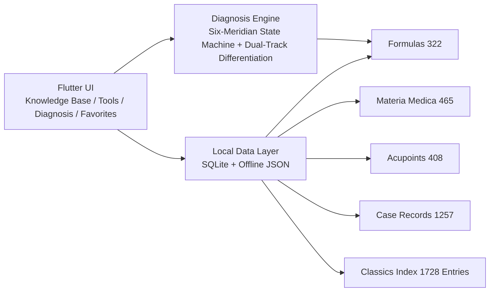

### Diagnosis Engine Design

**4-level formula matching strategy:**
1. Exact match on `name`
2. Alias match on `alias`
3. Slash-split matching (e.g. "Xiao Chaihu Tang / Da Chaihu Tang" takes the first)
4. Substring matching (e.g. "Guizhi Jia Houpo Xingren Tang" matches "Guizhi Tang")

**Colloquial enhanced matching (new in V1.11.9):** on top of the baseline literal matching above, `FormulaMatcher` adds weighted hits from the colloquial corpus — differentiation `indicators` weight 0.4, patient `oral` weight 0.15; the corpus is split into fragments by "、" and sentence breaks and compared fragment by fragment, with **negation words filtered out** ("no constipation" does not count as a "constipation" hit). The enhancement cap `enhancementCap = 0.9` is strictly less than 1, mathematically guaranteeing that **a higher baseline score always ranks first**: the new corpus only recovers formulas that previously had 0 hits, or reorders within the same score tier, and never disrupts the original correct ordering.

**Combined-disease detection:** 6-meridian scoring → exact condition matching → formula coverage
**Differential diagnosis:** meridian + pattern keywords + intake answers → 26 differentiation pairs
**Six-Meridian formula typing:** principal meridian → subtype table (Taiyang: wind stroke / cold damage / warm disease; Yangming: meridian heat / fu-organ heat; Shaoyin: cold transformation / heat transformation; Jueyin: mixed cold and heat / blood-deficiency cold reversal…), including pulse / treatment / representative formula / differentiation key points.

---

## 📜 Six-Meridian Pattern Differentiation System

| Meridian | Chief signs | Principal formula | Key points |
|:---:|:---|:---|:---|
| **Taiyang** | Floating pulse, stiff neck and headache, aversion to cold | Guizhi Tang / Mahuang Tang | The first gate of exterior patterns |
| **Yangming** | Heat without chills, stomach-family excess | Baihu Tang / Chengqi Tang | Yangming has no fatal pattern |
| **Shaoyang** | Bitter taste, dry throat, dizziness, alternating chills and fever | Xiao Chaihu Tang | Half-exterior half-interior; one sign is enough to confirm |
| **Taiyin** | Abdominal fullness, vomiting and diarrhea, inability to eat | Lizhong Tang / Sini Tang | Spleen deficiency with cold-dampness |
| **Shaoyin** | Faint thready pulse, constant desire to sleep | Sini Tang / Zhenwu Tang | Heart-Kidney Yang deficiency, warm urgently |
| **Jueyin** | Wasting thirst, Qi rushing upward to the heart, mixed cold and heat | Wumei Wan / Danggui Sini Tang | The end of Yin, with cold and heat bound together |

---

## 🗺️ Roadmap

- [x] Six-Meridian pattern differentiation smart diagnosis
- [x] Complete prescription generation (composition + dosage + decoction and administration + contraindications)
- [x] Classical-formula modification methods (23 rules)
- [x] Combined-disease expansion (14 types covered)
- [x] Differential diagnosis expansion (26 scenario pairs)
- [x] Diagnosis history trend chart (Six-Meridian transmission visualization)
- [x] Formula / herb / acupoint quick-reference enhancements (search + filters)
- [x] Zi Wu Liu Zhu acupoint-selection calculator
- [x] Classical-formula dosage converter
- [x] In-app update check (GitHub Releases)
- [x] Huangdi Neijing module (Zang-Xiang / inspection / pulse diagnosis + 73-chapter reading library + full-text search)
- [x] Raw / prepared Fuzi split (separate raw Fuzi / prepared Fuzi entries, zero broken links in composition references)
- [x] Master Ni's case-record library: 1257 searchable cases + closed-door-course severe-case clinical module
- [x] Seven-step intake and ten-question module v3.1 (follow-ups on pulse / pain / vomiting type)
- [x] Healthy-person baseline determination + eight-dimension true/false cold-heat method + Six-Meridian formula typing (V1.11.8)
- [x] Patient colloquial corpus: "What the patient would say" for 170 formulas + modern symptom-word recall (V1.11.9)
- [x] APK builds and releases automated by GitHub Actions (V1.11.9)
- [ ] Tongue-diagnosis AI assist (on-device TFLite model)
- [ ] Pulse-diagnosis assist (pulse classification)
- [ ] Formula comparison
- [ ] Export PDF diagnosis report

---

## ❓ Frequently Asked Questions

**Q1: Does the app need an internet connection?**
No. All knowledge bases (formulas, materia medica, acupoints, case records, classic texts) are bundled locally and work offline. By default only the "in-app update check" reaches GitHub; the optional "Ask Master Ni AI" connects only when you ask a question and have configured your own endpoint — it is off by default.

**Q2: Is my diagnosis data safe?**
Diagnosis history, favorites, and other data are all stored in the local SQLite database, never uploaded to any server, so private data never leaves the device.

**Q3: Which APK should I download?**
For most modern phones choose **arm64-v8a** (38.0MB, the smaller per-architecture build); if unsure, choose **Universal** (85.1MB, compatible with all architectures); for older 32-bit devices choose armeabi-v7a (35.7MB); for emulators choose x86_64 (39.6MB).

**Q4: What if installation says "App not installed" / "Installation failed"?**
Most likely an over-install rejected because of a **signature mismatch** or a corrupted package. Fix: **uninstall the old version first, then install the new one** (export your favorites and diagnosis history from "Settings" before uninstalling); if it still fails, try the universal APK instead.

**Q5: Are the Zi Wei / Yi Jing / Four Pillars modules medical features?**
No. These modules are **traditional Chinese folk-culture references**, clearly separated from the classical-formula medical modules in both UI and wording, and do not constitute any medical diagnosis or advice.

**Q6: Why is Fuzi split into "raw Fuzi" and "prepared Fuzi"?**
Following Ni Haixia's precise stance that "raw Fuzi is raw Fuzi, prepared Fuzi is prepared Fuzi, and one cannot substitute for the other", the app splits them into separate entries, and all 1663 composition references across formulas are resolved exactly to avoid misuse.

**Q7: How are the "Treatment / Disease" filters in the case-record library categorized?**
The Treatment column is categorized by the **classical-formula names** actually appearing in the case records (top 12 by frequency); the Disease column by **Western-medicine disease names** (extracted via a roughly 150-canonical-name dictionary with Simplified/Traditional normalization). All filtering logic is guarded by regression tests.

**Q8: What is "What the patient would say" in the diagnosis result?**
It is a "colloquial profile" this app adds to 170 classical formulas — translating the classical clauses of Shang Han Lun and Jin Gui Yao Lue back into the plain language a real patient would say at the bedside (e.g. Guizhi Tang: "I'm running a slight fever, and even though I keep sweating lightly, I feel cold whenever a breeze hits me, and I'm especially afraid of wind"), together with differentiation indicators, the core treatment, and the traceable original clause. You can check it line by line against yourself — "does this sound like something I'd say?"; for the engine it also acts as fallback corpus data, letting modern symptom words like "aversion to cold" and "aversion to wind" recall the corresponding classical formulas.

**Q9: How can I contribute?**
Issues and Pull Requests are welcome. See [Contributing](#️-contributing).

**Q10: Does "Ask Master Ni AI" cost money, and does it upload my medical history?**
No. Zhipu `GLM-4.7-Flash`, InternLM `Atria-Dawn` and Agnes `agnes-3.0-flash` are all free
models; sign up for a key and enter it in Settings (see **[Free model configuration guide](docs/free_api_guide.md)**).
On privacy: the feature is off by default with zero network traffic while off; once enabled
it sends only the retrieved lecture passages plus your question, when you actively ask —
no medical history or diagnosis records, and the API key stays in local SQLite. See
[🤖 Ask Master Ni AI](#user-content-ask-nishi-ai).

---

## 🤝 Contributing

Thanks for your interest in Hantang TCM! We welcome all forms of high-quality contributions.

### Code of Conduct

Please stay friendly, professional, and focused on the matter at hand. Keep discussions on fidelity to the classics and engineering quality, and respect the accuracy of Ni Haixia's academic system.

### Coding Standards

- Follow the [Dart Style Guide](https://dart.dev/effective-dart/style) and `flutter_lints`;
- Always run `flutter analyze` and `flutter test` before committing, ensuring **0 errors**;
- Changes to key pattern-differentiation paths, filtering logic, or rendering layouts **must** add / update regression tests;
- Use **Material Icons** for all UI feature icons (the only exception: the eight trigrams ☰☱☲☳☴☵☶☷ are semantic symbols from the Yi Jing and are kept);
- Reference all colors through the semantic tokens in `lib/theme/app_colors.dart` (`context.colors`); no hardcoding;
- Versioning rule: `pubspec.yaml`'s `version: X.Y.Z+N` is the single source of truth; increment the patch and build numbers with each release.

### Submission Workflow

1. Fork this repository;
2. Create a feature branch: `git checkout -b feature/amazing-feature`;
3. Commit your changes (following Conventional Commits): `git commit -m 'feat: add amazing feature'`;
4. Push the branch: `git push origin feature/amazing-feature`;
5. Open a Pull Request and describe in it: what changed, test results, and the impact on related pattern differentiation / data.

### Commit Message Guidelines (Conventional Commits)

| Prefix | Meaning |
|:---|:---|
| `feat:` | New feature |
| `fix:` | Bug fix |
| `docs:` | Documentation changes |
| `refactor:` | Refactoring (no behavior change) |
| `test:` | Tests |
| `chore:` | Build / toolchain |

---

## 📄 Open Source License

This project is released under the **Apache License 2.0**.

- See [LICENSE](LICENSE) for the full license text;
- You may freely use, modify, and distribute this software, including for commercial purposes, provided you retain the copyright and license notices and follow the Apache 2.0 terms (including change notices and NOTICE file requirements).

© 2026 jangviktor-web

---

## 📚 References

| Source | Content |
|:---|:---|
| Ni Haixia's Renji lecture series | Shang Han Lun, Jin Gui Yao Lue, Huangdi Neijing, Zhenjiu Dacheng, Shennong Bencao Jing |
| Zhang Zhongjing's Shang Han Lun | Six-Meridian pattern differentiation system |
| Zhang Zhongjing's Jin Gui Yao Lue | Miscellaneous-disease pattern differentiation |
| Shennong Bencao Jing | Herb nature, flavor, and meridian tropism (448 kinds) |
| Wsy-prog/tcm-diagnosis-system (MIT) | Structural reference for the core TCM pattern differentiation module (v3.4), a comparative reference for enhancing Six-Meridian guided intake |
| ziwei_core (Dart, MIT) | Zi Wei Dou Shu / Ba Zi / Ming Gua chart engine (fully offline) |
| sxwnl_spa_dart (Dart) | Calendar / True Solar Time / solar-term calculation (lunar calendar · stems-branches · solar terms) |

> This app draws on and uses the open-source projects above, with attribution as required by their licenses; thanks to the original authors and the community.

---

## ⚠️ Disclaimer

This app is a TCM classical-formula **learning and auxiliary reference tool**; no pattern-differentiation result or formula suggestion can replace diagnosis and treatment by a licensed physician. Follow your doctor's advice when taking medication, and seek immediate medical care for acute or severe conditions. The metaphysics-related modules are folk-culture references and are unrelated to medicine.

---

## 🌟 Star History

[](https://repostars.dev/?repos=jangviktor-web%2Fnihaixia-app&theme=grape)

---

<div align="center">

**⭐ If this project helped you, please give it a Star!**

</div>
