<div align="center">


# 漢唐中醫 · 倪海廈六經辨證中醫 AI 診斷助手

**一款離線優先、完全免費的中醫經方學習與輔助診斷 App，忠實還原倪海廈人紀體系**

**🤖 問倪師AI（可選）｜本機講義檢索 + 自配模型，讓倪師講義開口回答**

離線優先 · 資料全本地 · 無需註冊 · 開箱即用（不開啟 AI 時完全離線）

[簡體中文](README.md) · **繁體中文** · [English](README.en.md)

<a href="https://trendshift.io/repositories/108262?utm_source=trendshift-badge&amp;utm_medium=badge&amp;utm_campaign=badge-trendshift-108262" target="_blank" rel="noopener noreferrer"></a>
<a href="https://trendshift.io/repositories/108262?utm_source=trendshift-badge&amp;utm_medium=badge&amp;utm_campaign=badge-trendshift-108262" target="_blank" rel="noopener noreferrer"></a>

[](https://github.com/jangviktor-web/nihaixia-app/releases/latest)
[](https://flutter.dev)
[](https://dart.dev)
[]()
[](LICENSE)
[](https://github.com/jangviktor-web/nihaixia-app/stargazers)

<br/>

**[🌐 線上網頁版](#user-content-online-web)** · **[🤖 問倪師AI · 免費 API](#user-content-ask-nishi-ai)** · **[📥 下載 APK](#-下載安裝)** · **[📖 快速上手](#-快速上手)** · **[🏗️ 技術架構](#️-技術架構)** · **[🗺️ Roadmap](#️-roadmap)** · **[🤝 貢獻指南](#️-貢獻指南)** · **[📄 開源許可](#-開源許可)**

</div>

---

## 📖 專案簡介

> 「中醫很簡單，就是陰陽氣血。你搞懂了，一通百通。」—— 倪海廈

**漢唐中醫** 是一款以倪海廈《人紀》系列（傷寒論、金匱要略、黃帝內經、針灸大成、神農本草經）為理論根基的中醫經方輔助工具。它將經典六經辨證體系工程化，幫助你：

- **循證辨證**：以六經為綱，疊加《金匱》證候族鑑別，引導式問診自動推導證型與主方；
- **即查即用**：方劑、本草、穴位、針灸處方、醫案、經典著作全部離線收錄，隨時隨地檢索；
- **有據可查**：1257 例倪師醫案與方劑雙向聯動，辨證思路可回溯；
- **素養提升**：黃帝內經知識卡、紫微/易經/四柱等民俗文化工具，構建完整傳統文化視野。

### 核心價值主張

| 維度 | 說明 |
|:---|:---|
| 🔒 **離線優先** | 所有知識庫打包進 App，無網路也能用，隱私資料不出本機 |
| 📚 **經典還原** | 嚴格遵循倪師"生附子、炮附子不可取代"等口徑，附子按體系拆分，方劑組成零死鏈 |
| 🧠 **引擎驅動** | 自研六經辨證狀態機 + 雙軌鑑別樹，322 首方劑可達，診斷邏輯可驗證 |
| 🆓 **完全免費** | Apache 2.0 開源協議，無廣告、無內購、無追蹤 |
| 🧪 **測試守護** | 關鍵辨證路徑與篩選邏輯均有迴歸測試，修復即寫測試，防止復發 |

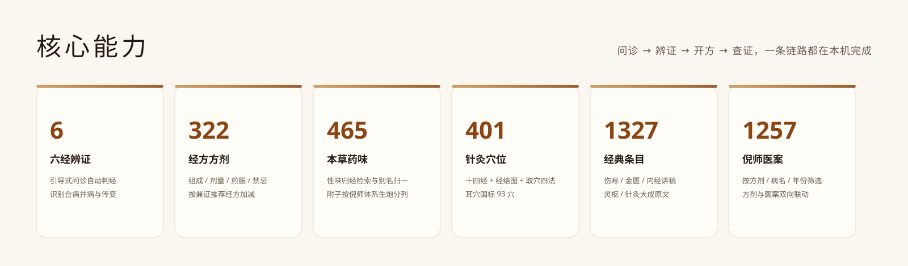

---

<a name="online-web"></a>

## 🌐 線上網頁版：免安裝，點開就用

不想裝 APK？瀏覽器直接打開，功能與 APK 一致（六經問診、方劑本草穴位、經典全文檢索、問倪師AI）：

**[👉 jangviktor-web.github.io/nihaixia-app/web](https://jangviktor-web.github.io/nihaixia-app/web/)**

> ⚡ **中國大陸訪問 GitHub Pages 偏慢？** 用國內鏡像，開啟更快：
> **[👉 漢唐中醫 · 線上版（國內鏡像）](https://ae68ddd6e40fef14f.app.workbuddy.host/?sharecode=JAIBL7UGO6)**
> 功能與網頁版一致；鏡像為定期同步的快照，可能略舊於 GitHub 版。連結**必須完整包含 `?sharecode=`**，缺失會回傳 403。

三點實話：**收藏與對話記錄只存在目前瀏覽器**（IndexedDB，換瀏覽器 / 清快取即遺失，不與 APK 互通）；**首次開啟約 75MB**（渲染引擎 + 離線古籍，建議 Chrome / Edge）；**繁簡轉換首次需連網**（OpenCC 走 CDN），其餘斷網可用。長期使用仍建議裝 APK。

---

<a name="ask-nishi-ai"></a>

## 🤖 問倪師AI：把倪師講義，交給你的模型

「問倪師AI」是 App 裡**唯一可選的連網功能**。它不是把問題直接丟給一個通用大模型，
而是**先在本機講義庫檢索，再把命中的原文片段連同出處一起交給你自己設定的模型作答**；
講義裡沒有的，它會明說「講義裡沒有」，而不是替倪師編一段。

> [!TIP]
> **💰 零成本起步：免費 API，5 分鐘就能用**
> App 不內建任何端點，也不代收費用。註冊一個 OpenAI 相容服務的免費 Key，
> 填進「設定 → AI 講義問答」即可。**首選智譜 `GLM-4.7-Flash`**：
> 國內直連、免費、回應快，文字問答綜合最優。智譜 / 書生 / Agnes 三家的端點、
> 模型名、注意事項與逐項步驟見 **[免費模型配置指南](docs/free_api_guide.md)**。

### 它和「直接問通用 AI」有什麼不同

| | 通用 AI 問答 | 問倪師AI |
|:---|:---|:---|
| 回答依據 | 模型自己的參數記憶，容易把經方講串 | 本機講義庫命中片段：傷寒 394 條 / 金匱 / 針灸 / 本草 / 醫案 1257 例 / 病名對照 48 條 |
| 出處 | 通常給不出 | 片段連同出處一起進上下文，回答裡的參考片段可點開原文 |
| 跑偏防護 | 靠模型自覺 | 回答裡出現講義與醫案都沒有的方名時，自動標註「N 處方名未在講義片段中出現」 |
| 端點 | 廠商固定 | 你自己填 OpenAI 相容端點，換模型只改三項 |
| 連網 | 預設連網 | **預設關閉**，關閉時零網路請求 |

### 一次提問，App 做了什麼

1. **本機檢索**：按病名古今／中西醫叫法、方名、關鍵詞三級優先順序，在本機講義庫找片段。
2. **組裝上下文**：把命中原文 + 出處 + 病名對照 + 相關方劑的禁忌要點一起交給模型。
3. **按結構作答**：回答按「主證表格 → 辨證結論 → 方劑思路」組織，底部固定免責框；方劑名、藥材名、穴位名都能點開詳情。
4. **出處稽核**：核對回答裡的方名是否真的出現在講義片段中，缺的列出來提醒，避免把模型自帶知識當成倪師原話。

### 能力一覽

- **多對話與續接**：對話存本機 SQLite，退出頁面、關掉程式後重開還在；歷史對話按「今天 / 昨天 / 7 天內 / 更早」分組，可切換、重新命名、刪除
- **方劑禁忌進上下文**：辨到某個方時，連禁忌與要點一併給模型，能回答「什麼情況不能用這個方」，而不只是「這個方治什麼」
- **病名對照自動注入**：古今病名、中西醫叫法對照進上下文，回答下方可展開查看命中條目
- **回答內跳轉**：方劑、藥材、穴位、參考片段都能點進對應詳情頁，邊答邊查
- **一鍵拉取模型清單**：設定裡可直接讀取端點的模型清單，不用手敲模型名
- **任何相容端點都能接**：OpenRouter、本機 Ollama 等 OpenAI 相容服務同樣可用

### 三步開啟

1. 按 [免費模型配置指南](docs/free_api_guide.md) 挑一家免費服務，註冊並建立 API Key
2. 「設定 → AI 講義問答」填入 **介面位址 / API Key / 模型名**（可一鍵拉取模型清單）
3. 打開開關，回到知識庫點右上角「問倪師AI」提問

> [!IMPORTANT]
> **隱私邊界**：該功能**預設關閉**，關閉時 App 不發出任何網路請求；開啟後也只有你主動提問時才連網，
> 傳送的是「檢索到的講義片段 + 你的問題」，**不上傳病史、不上傳診斷紀錄**；API Key 只存本機 SQLite。
> 任何辨證結果與方劑建議均不可替代執業醫師的診斷與治療。

完整設定項見 [⚙️ 詳細配置選項說明 · 第 2 節](#️-詳細配置選項說明)，
免費方案的 Key 取得路徑、逐項截圖與常見錯誤見 [免費模型配置指南](docs/free_api_guide.md)。

---

## 📷 截圖

<div align="center">

**v1.11.32 問倪師AI · 症狀自查 —— 本地講義檢索 + 你自配的端點 + 一頁勾選出結論**

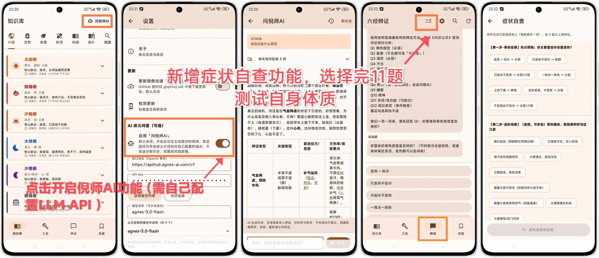

</div>

① **知識庫入口** —— 右上角「問倪師AI」，未開啟時按鈕不出現。

② **設定 → AI 講義問答** —— 端點位址 / API Key / 模型名全部由你自己填，開關預設關閉；關閉即完全不連網。

③ **問答過程** —— 先把本地講義片段餵給模型，回答按「主證表格 → 辨證結論 → 方劑思路」組織，底部固定免責框；回答裡的方劑名、藥材名、穴位名都能點開詳情。

④ **症狀自查入口** —— 「辨證」Tab 右上角的清單圖示。

⑤ **症狀自查** —— 寒熱總綱（必選）→ 進階線索（選填）→ 十一問，選滿 3 項即可出結論，方劑可繼續點進詳情。

<details>
<summary><b>📁 歷史版本截圖（v1.11.31 → v1.11.0，按版本從新到舊）· 點選展開</b></summary>

<div align="center">

**v1.11.31 傷寒論模組排版更新 · 全部宋本傷寒論排序 · 簡繁體切換**

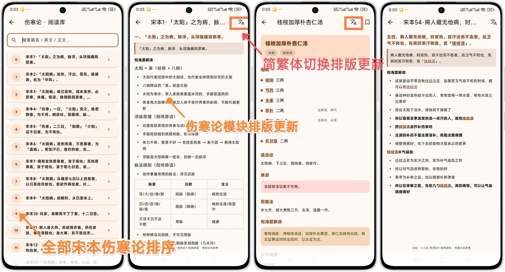

</div>

從左到右：① **傷寒論閱讀庫** —— 全部條文按宋本 1–390 順序排列，列表名統一「宋本N·」，篇名 / 條文 / 正文可搜。 ② **宋本1 條文卡** —— 原文塊 +「倪海廈解讀」，脈法陰陽等表格完整呈現，右上角簡繁切換。 ③ **桂枝加厚朴杏仁湯方劑詳情** —— 組成 / 適應證 / 禁忌 / 煎服法 / 倪海廈解讀與底部「見於經典」分組，繁體顯示同步生效。 ④ **宋本54 條文卡** —— 繁體模式下的原文與解讀排版。

<div align="center">

**v1.11.30 條文卡講解全覆蓋（839 張）· 繁體顯示開關 · 繁體輸入可搜 · 醫案簡體化**

</div>

- **條文卡講解覆蓋 100%**：傷寒 384 + 金匱 433 共 839 張條文卡全部配有講解正文（合併 22 組「問曰/師曰」問答卡，金匱 455→433 條）
- **繁體顯示**：閱讀頁 / 藥材詳情 / 方劑詳情右上角 `translate` 圖示一鍵切換，OpenCC 詞典級轉換（簡體「干姜」→「乾薑」、「郁金」→「鬱金」），連結仍可點跳
- **繁體輸入可搜**：搜「當歸」「麻黃湯」不再空結果（三處檢索入口繁簡歸一）
- **醫案庫整備**：全文簡體化、藥材異名對映 135 條、處方藥材解析率 94.1%
- 新增藥材「石菖蒲（九節菖蒲）」；方劑 327→314 條（淨合併 13 組同方異名）

**v1.11.29 針灸講稿閱讀庫（72 篇）· 講稿⇄穴位雙向聯動**（當前最新截圖）

<div align="center">

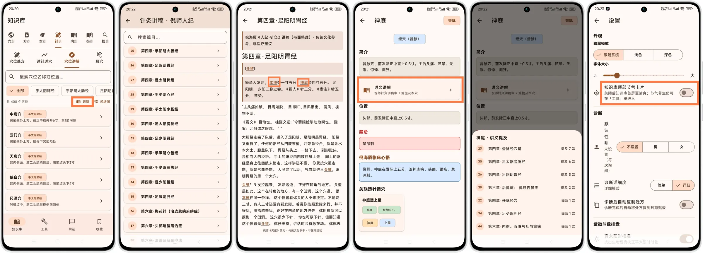

</div>

從左到右：① **針灸講稿入口** —— 知識庫「針灸」頁穴位篩選行新增「講稿」按鈕，與「經絡圖」並列。 ② **針灸講稿 · 篇目錄** —— 《人紀·針灸》72 篇按章節排列（針灸使用時機 / 針刺深淺 / 十二經絡與奇經八脈 / 針刺手法 / 從頭到腳治症系列），篇名即時搜尋。 ③ **講稿正文閱讀** —— 書面整理版排版，正文中的穴位名（頭維 / 本神 / 神庭）、方劑名、藥材名自動成鏈，一點直達詳情。 ④ **穴位詳情 ·「講義講解」卡** —— 穴位詳情頁新增講義卡，顯示講稿中提及本穴的篇數（如神庭 7 篇提及），無命中自動隱藏。 ⑤ **神庭 · 講義提及列表** —— 底部彈層按提及次數排序列出各篇（督脈經穴篇 7 次 / 足太陽膀胱經 6 次 / 治鼻病 2 次……），點按直達該篇。 ⑥ **節氣卡可隱藏** —— 設定 → 外觀新增「知識庫頂部節氣卡片」開關，關閉後知識庫首頁更清爽，節氣養生仍可從「工具」進入。

<div align="center">

**v1.11.27 三山國王靈籤 · 小六壬 · 梅花易數 · 排盤存圖分享長圖 · 搖一搖起卦**

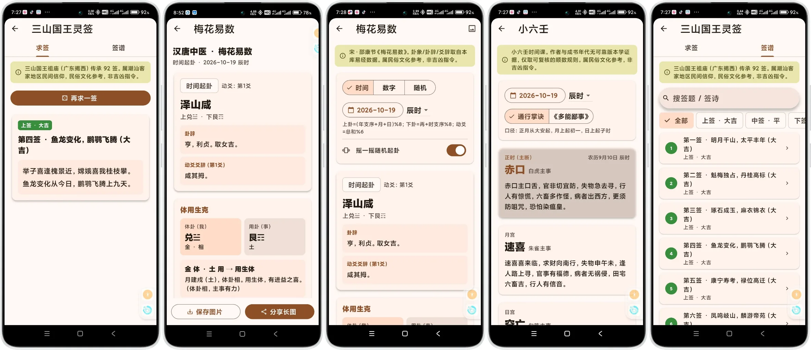

</div>

從左到右：① **三山國王靈籤 · 求籤** —— 收錄廣東揭西三山國王祖廟傳承 92 籤，每籤含籤號 / 籤題 / 籤詩原文 / 吉凶等級；默唸所問之事後搖取籤文，可反覆再求。② **梅花易數 · 排盤結果** —— 隨機起卦得「澤山鹹」，動爻、卦辭、動爻爻辭與體用生克推演一屏看全；AppBar 圖片入口進入長圖預覽頁，「儲存圖片」（存本機、**無需儲存許可權**）與「分享長圖」（調起系統面板，可轉存相簿 / 檔案 / 微信）兩個出口。③ **梅花易數 · 搖一搖起卦** —— 輸入區「搖一搖隨機起卦」開關預設開啟，搖動手機即自動切隨機起卦並重搖一卦（不動已輸入的時間 / 數字），觸覺反饋確認；一次搖動只出一卦，緩慢傾斜不誤判。④ **小六壬** —— 時間起課，月 / 日 / 時三宮順數定大安 / 留連 / 速喜 / 赤口 / 小吉 / 空亡，配主事六神與歌訣；術內對「月初一落宮」本有分歧，**「通行掌訣」與《多能鄙事》雙口徑並列**由使用者自選，推算過程完整展示。⑤ **三山國王靈籤 · 籤譜** —— 92 籤全量列表，按吉凶（上 42 / 中 31 / 下 17 / 無事 2）篩選 + 籤題與籤詩全文檢索，點按彈出完整籤文。三個模組均標註民俗文化參考免責宣告，與經方醫療模組清晰分隔；存圖長圖同適用於八字排盤 / 紫微斗數 / 五運六氣結果頁。

<div align="center">

**v1.11.26 耳穴國標定點陣圖 · 十四經循行穴點陣圖 · 五運六氣三圖排版修復**

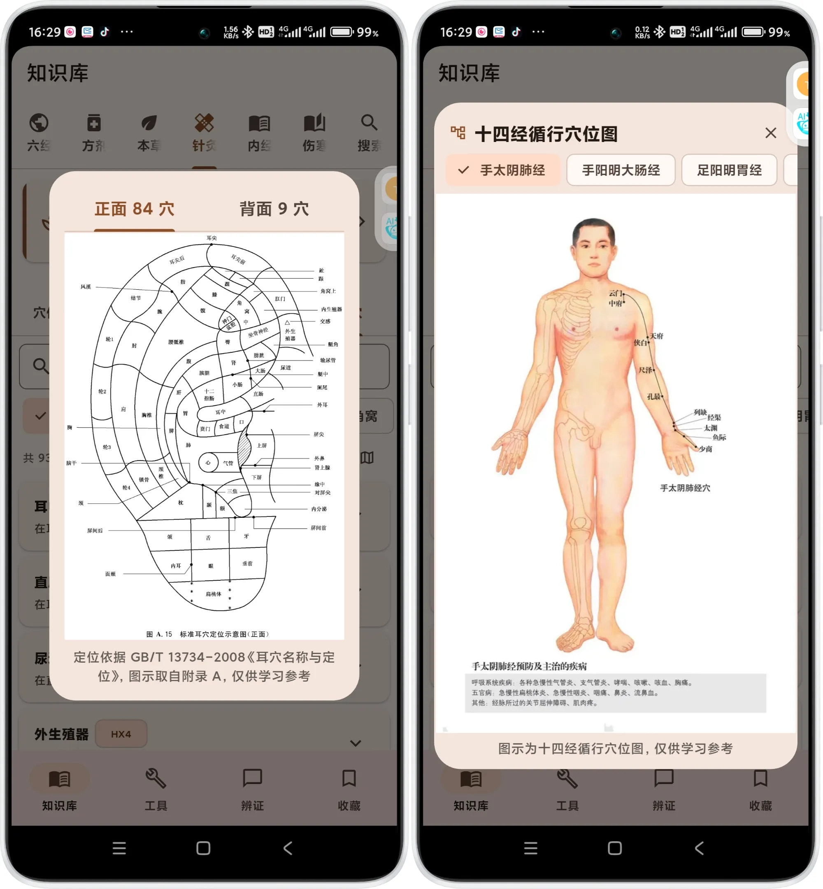

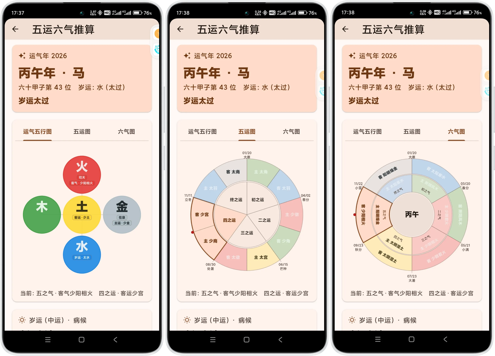

</div>

從左到右：① **耳穴國標定點陣圖** —— 耳穴地圖內嵌 GB/T 13734-2008《耳穴名稱與定位》附錄 A 標準圖，「正面 84 穴 / 背面 9 穴」兩頁籤，雙指放大細看穴名，頁內標註「僅供學習參考」；配套「耳穴」庫 93 穴按國標分割槽（HX/SF/AH/CO……）篩選，穴名 / 拼音 / 程式碼均可檢索。 ② **十四經循行穴點陣圖** —— 穴位講解新增「經絡圖」入口，十二正經 + 任督二脈共 14 張循行圖，經絡走行、所屬穴位與該經「預防及主治的疾病」一圖看全，雙指放大 6 倍看清穴名。 ③–⑤ **五運六氣三圖排版修復** —— **運氣五行圖**五宮半徑與間距重新配比，徽章不再橫跨壓字；**五運圖**主客運分色、步界日期清晰；**六氣圖**「外環客氣 / 內環主氣 / 步名」三層文字改沿扇區切線排布，3 點與 9 點方向不再疊壓；任選日期三圖即時重繪、當前步自動高亮（圖為 2026 丙午年）。

<div align="center">

**v1.11.25 易經 64 卦卦象插畫 · 中醫時辰開穴四法 · 五運六氣三圖**

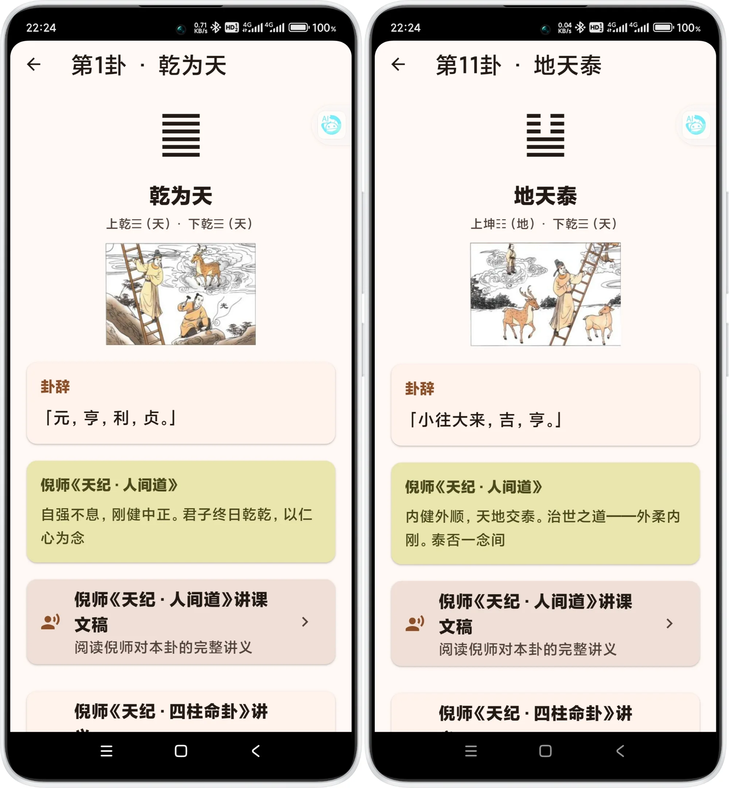

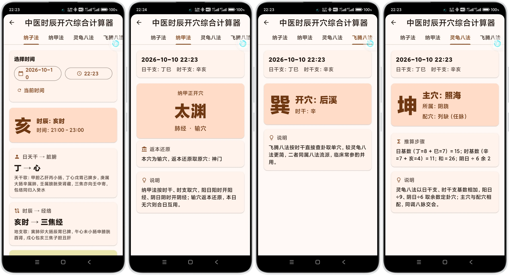

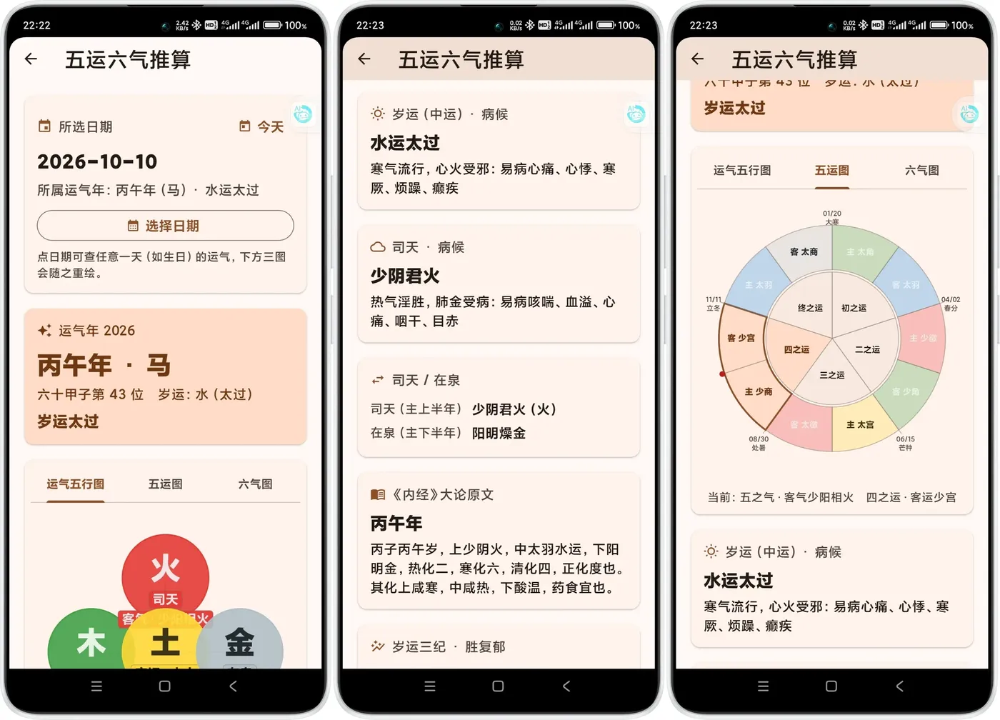

</div>

從左到右：① **易經 64 卦卦象插畫** —— 每卦詳情頁卦名下方顯示該卦的傳統典故版畫（乾為天 = 雲中取鹿、地天泰 = 梯上取鹿），64 卦全覆蓋，與卦名資料一一對應，缺圖靜默收起不影響頁面。 ② **中醫時辰開穴綜合計算機 · 四法並排** —— 納子法 / 納甲法 / 靈龜八法 / 飛騰八法四個 Tab，點選或按「當前時間」即時給出日干支與時干支，並顯示開穴（納甲正開 · 太淵「肺經·輸穴」、飛騰八法 · 後溪、靈龜八法 · 照海配列缺），附「返本還原」還原取原穴、干支→臟腑/經絡對應歌訣、推算步驟與說明。 ③ **五運六氣三圖** —— **運氣五行圖**（十字五宮夾中央，司天/在泉與五行圓形聯動）、**五運圖**（單環十扇區，主運/客運分色並標出步界日期）、**六氣圖**（雙環）；任選一天（如生日）三圖隨之重繪，當前步高亮，下方給出歲運（中運）病候、司天/在泉、客氣加臨與《內經》大論原文。

<div align="center">

**v1.11.24 穴位篩選新增六奇經分組 · 國標穴序**


</div>

穴位講解的經絡篩選從 15 組擴到 **21 組**：十二正經 + 督任之外，新增**衝脈 / 帶脈 / 陰維脈 / 陽維脈 / 陰蹺脈 / 陽蹺脈**六個奇經分組；57 條交會穴補齊所屬經脈標註，多脈穴忠實出現在所有所屬脈分組（如公孫同時在「脾經」與「衝脈」），搜「衝脈」等可直接命中其交會穴。隨版帶出：十二正經 / 督任組內按國標穴序排列、同名並列穴位次鍵修復、「子宮」解剖語境禁鏈。

<div align="center">

**v1.11.23 傷寒論 / 金匱要略 條文級閱讀庫 · 方劑⇄條文雙向聯動**

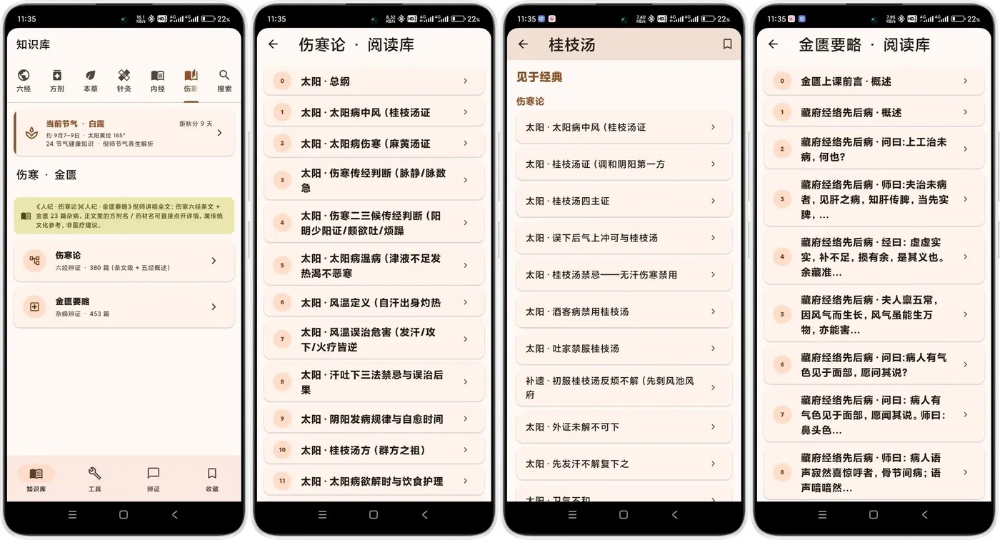

</div>

從左到右：① **知識庫新增「傷寒金匱」Tab** —— 傷寒論 380 篇（條文級 + 五經概述）與金匱要略 453 篇兩個入口。 ② **傷寒論 · 閱讀庫** —— 23 大模組拆到條文級逐條排列（太陽·總綱 / 太陽病中風(桂枝湯證) / 太陽病傷寒(麻黃湯證) / 太陽病傳經判斷 ……）。 ③ **方劑「見於經典」** —— 以桂枝湯為例，分「傷寒論 / 金匱要略」兩組列出**專門介紹該方**的條文，點按直達原文。 ④ **金匱要略 · 閱讀庫** —— 25 篇雜病按條文排列（藏府經絡先後病、痙溼暍病、瘧病 ……）。正文裡的方劑名 / 藥材名一點即跳對應詳情，經方正文與方劑·藥物首次**雙向聯動**。

<div align="center">

**v1.11.19 內經結構化條目檢索 · 節氣養生**

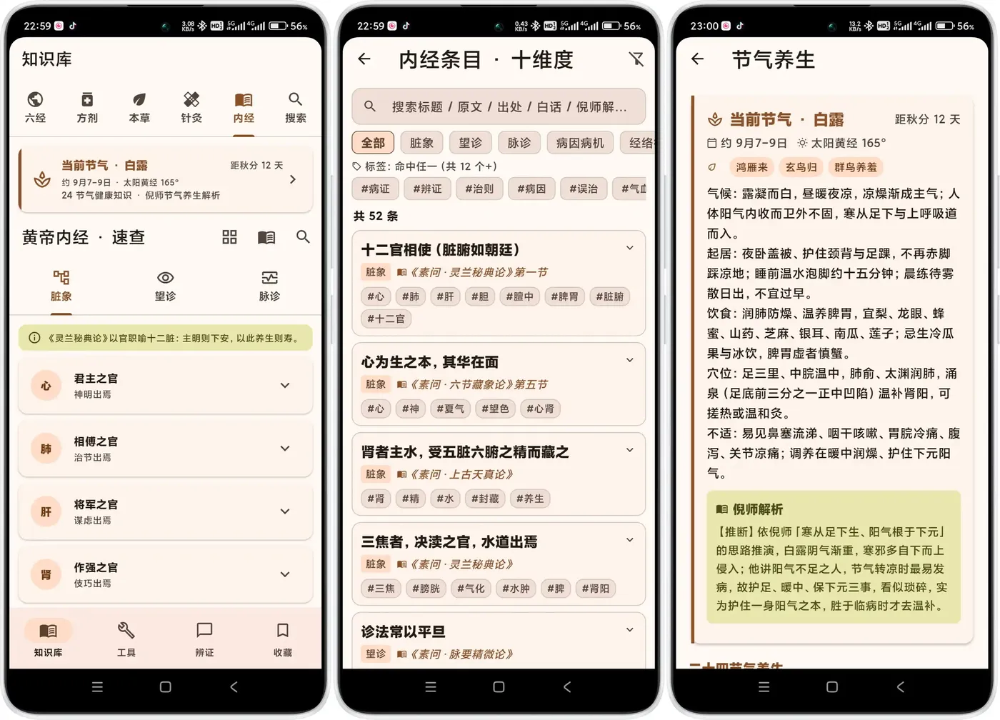

</div>

從左到右：① **知識庫首頁** —— 頂部「六經 / 方劑 / 本草 / 針灸 / 內經 / 搜尋」六大入口，「當前節氣」卡直顯節氣名、距下一節氣天數、太陽黃經與三候，下方「黃帝內經·速查」臟象 / 望診 / 脈診三入口一覽。 ② **內經條目 · 十維度** —— 52 條結構化條目按 10 個維度（臟象 / 望診 / 脈診 / 病因病機 / 經絡循行 / 氣血津液 / 辨證體系 / 治則方藥 / 病證舉例 / 誤治宜忌）檢索，支援六欄位搜尋（標題 / 原文 / 出處 / 白話 / 倪師解）、按篇名檢索與標籤交叉篩選；每條卡片顯式標註篇名出處（如《素問·靈蘭秘典論》第一節）。 ③ **節氣養生詳情** —— 24 節氣逐條給出氣候 / 起居 / 飲食 / 穴位 / 不適五類養生要點，並附「倪師解析」卡片，非原文直引處統一標註【推斷】，一眼可分「經典原文 vs 解讀」。

<div align="center">

**v1.11.17 周公解夢 · 小兒關煞 · 紫微早晚子時校正**

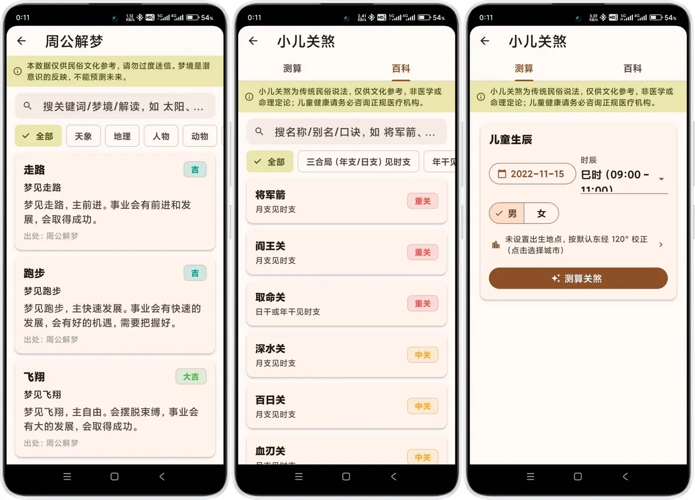

</div>

新增「周公解夢」模組（412 條夢境民俗解讀，關鍵詞/分類檢索，吉凶標註）；新增「小兒關煞」模組（36 關 + 18 擴充煞，支援測算與百科檢索，附民俗文化參考免責宣告）；紫微排盤早晚子時校正重構，原始出生時間只讀、農曆顯示跟隨校正後的干支。

<div align="center">

**v1.11.13 每日黃曆 · 生肖相沖 / 玉匣記神仙節日 + 潮汕節俗 / 玉匣靈兆模組**

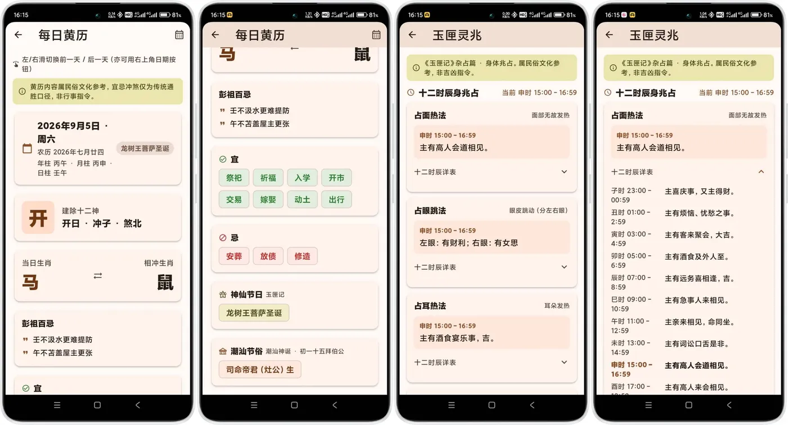

</div>

從左到右：① **每日黃曆 · 生肖相沖** —— 依每日地支經六沖推算當日相沖生肖（如子日衝馬），一眼看清。 ② **每日黃曆 · 玉匣記神仙節日 + 潮汕節俗** —— 玉匣記收三元五臘聖誕（114 條）、十殿閻君（10 條）與齋期，共 125 個農曆日；潮汕地方條目單列（如「司命帝君」「灶公生」），與既有傳統節日執行時去重互不覆蓋。 ③ **玉匣靈兆 · 占面熱法** 與 ④ **玉匣靈兆 · 占眼皮法** —— 玉匣記身體兆占，十二時辰各占斷，當前時辰自動高亮，可展開十二時辰詳表（左眼跳財、右眼有女思等）；工具頁新增入口，附民俗參考免責宣告。

<div align="center">

**倪師醫案庫 · 閉門課重症臨床 · 六爻銅錢搖卦 · 實用工具**

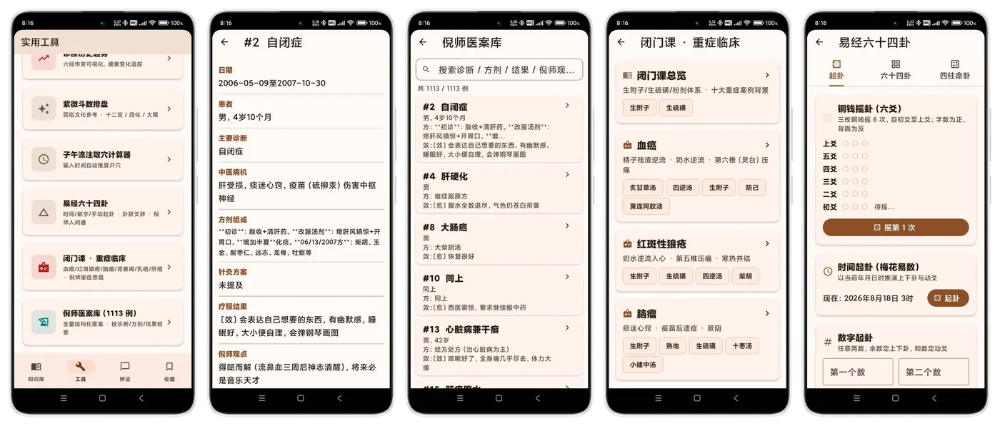

**黃帝內經：臟象 · 望診 · 脈診 · 73 篇閱讀庫**

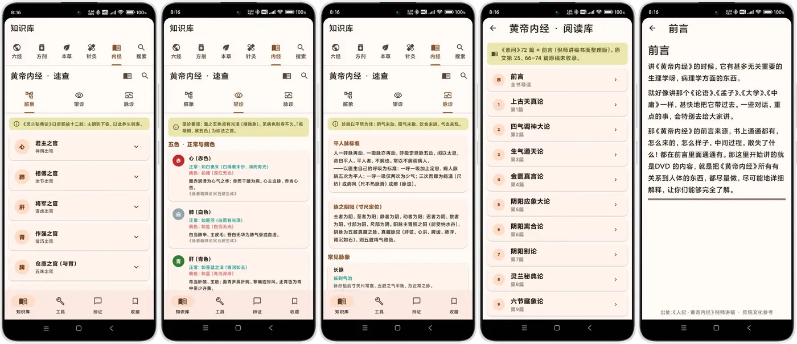

**問診引導 · 六經速查 · 方劑速查**

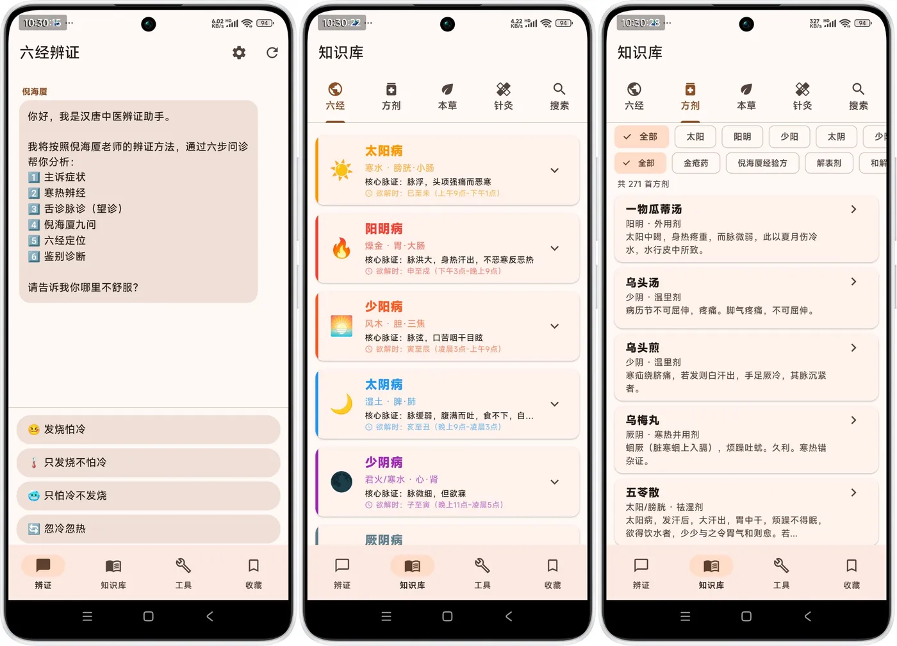

**本草速查 · 針灸穴位 · 實用工具**

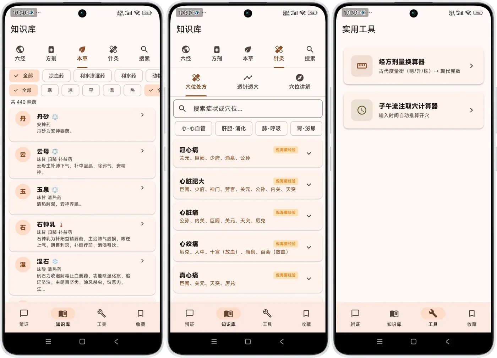

**四柱命卦 · 紫微斗數排盤 · 易經六十四卦**

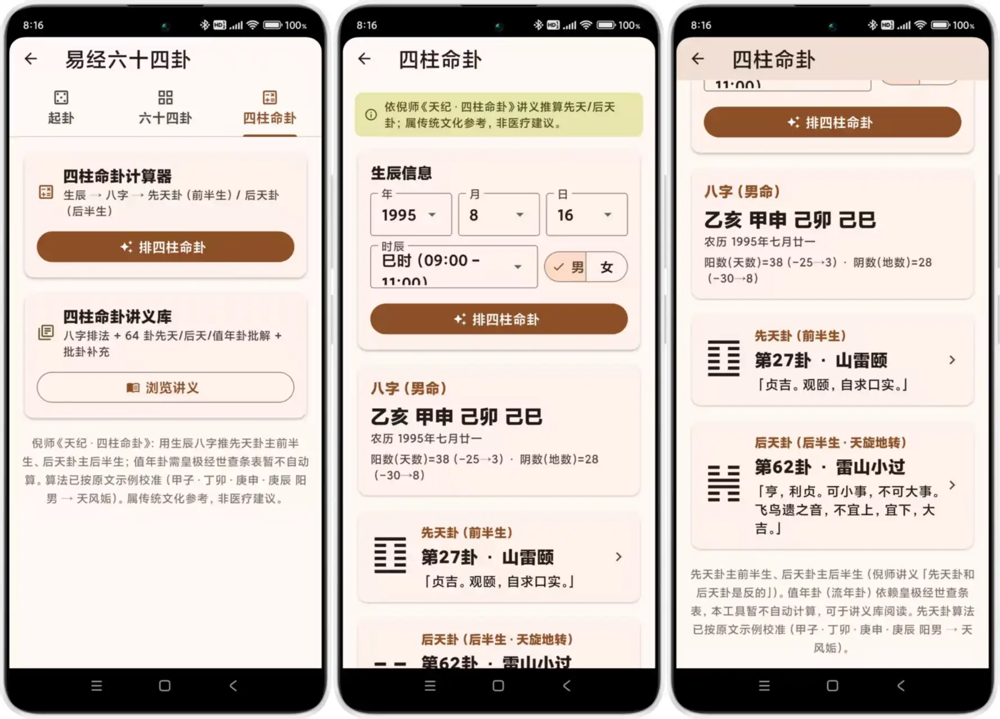
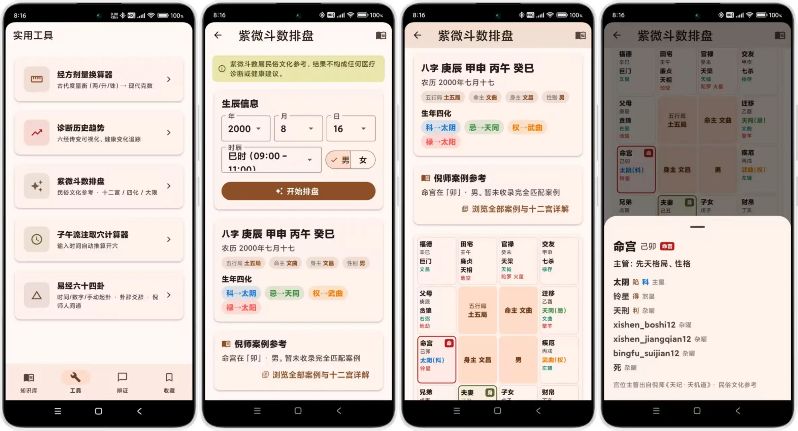
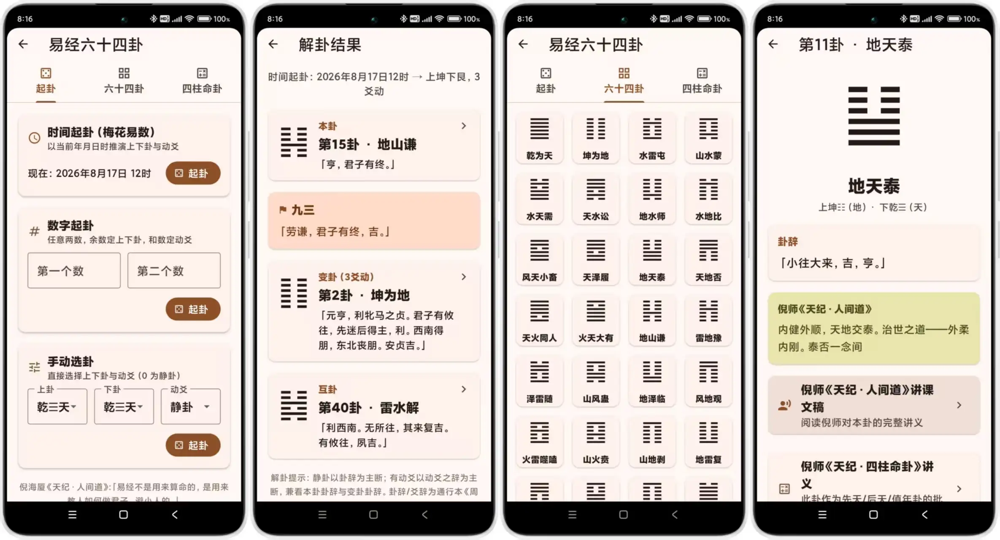

**倪師閉門課內容 · 倪師精選醫案**


**新增每日黃曆、節氣養生模組 ·  最佳化紫微斗數星盤大運、流年月詳解功能及“真太陽時”選擇地名自動匹配功能**


</div>

</details>

---

## ✨ 核心功能與特性亮點

| 功能 | 說明 | 資料規模 |
|:---|:---|:---:|
| 🩺 **六經辨證診斷** | 智慧問診引導，自動判斷太陽/陽明/少陽/太陰/少陰/厥陰，並支援合病並病 | 6 經 |
| 💬 **患者口語畫像** | 把文言條文翻成大白話主訴，逐句自核；讓「怕冷/怕風」等現代詞也能召回古方 | 170 首 |
| 📋 **完整處方生成** | 自動顯示組成、劑量、煎服法、禁忌，推薦經方加減 | 23 條規則 |
| 🔍 **鑑別診斷** | 自動對比相似證型的關鍵區別，輔助精準辨證 | 26 對 |
| 📚 **方劑速查** | 搜尋 + 六經篩選 + 分類篩選，離線查閱 | 322 首 |
| 🌿 **藥物速查** | 搜尋 + 分類/性味/歸經三篩選，覆蓋《神農本草經》全量，附子按倪師體系拆分生/炮兩條 | 465 味 |
| 📍 **針灸穴位速查** | 十四經脈 + 經外奇穴，含定位/針刺/灸法/禁忌/臨床心悟，穴位↔處方雙向關聯 | 401 穴 |
| 💉 **穴位處方·透針** | 14 類針灸處方（257 條）+ 31 條透針透穴，組成穴可點按跳轉 | 14 類 |
| ⏰ **子午流注取穴** | 輸入時間自動推算開穴 | 361 穴 |
| 🔧 **經方劑量換算** | 古代度量衡（兩/升/銖）→ 現代克數 | — |
| 📖 **黃帝內經** | 臟象卡 + 望診 / 脈診 + 73 篇閱讀庫；結構化條目 52 條 / 10 維度，支援六欄位 + 標籤交叉檢索 | 73 篇 + 52 條 |
| 📜 **傷寒論 · 金匱要略 條文庫** | 394 + 433 篇拆到條文級，正文方劑 / 藥名可點跳詳情，方劑頁反向標註出處條文 | 827 條 |
| 📜 **古籍原文** | 《靈樞》82 章 + 明代《針灸大成》339 章原文，章節目錄可搜正文，方劑/藥名可點跳；全域搜尋「經典」分組貫通講稿與原文 | 421 章 |
| 📚 **倪師醫案庫** | 1257 例檢索 + 閉門課重症臨床模組，醫案 ↔ 方劑雙向聯動 | 1257 例 |
| 🎲 **六爻銅錢搖卦** | 三枚銅錢逐爻搖卦，多動爻自動變卦 | 民俗參考 |
| 📜 **易經六十四卦** | 時間/數字/手選起卦，解本卦·動爻·變卦·互卦，整合人間道 64 卦講課文稿 | 64 卦 |
| ☯️ **四柱命卦** | 先天/後天卦推算（天地數法），附倪師四柱命卦講義庫 | 64 卦 |
| 🔮 **紫微斗數排盤** | 十二宮/主星/四化/大限/流年盤視覺化，雜星全中文，支援真太陽時+經度；排盤後自動生成整體運勢/十年大運/流年總結，並給流年疾厄宮健康提醒（民俗文化參考） | 115 星 |
| 📊 **八字詳批** | 神煞/格局/日主強弱/五行分佈/用神忌神，一鍵詳批 | 民俗參考 |
| 💾 **我的命盤庫** | 紫微排盤結果可命名收藏，列表管理、左滑刪除、點選回看（回填生辰與城市重排），省去反覆輸入 | — |
| 🍂 **節氣養生板塊** | 獨立 24 節氣板塊，每條附健康養生要點 + 倪師節氣解析（非原文標註【推斷】），與本草庫解耦 | 24 節氣 |
| 👆 **每日黃曆手勢** | 黃曆支援上/下滑切日、左/右滑切月，單手翻看更順手，保留日期選擇器兜底 | — |
| 🔁 **大運對宮解析** | 大限空宮時自動附對宮主星/煞星提示，紫微「借星安宮」慣例視覺化 | — |
| 🔔 **應用內更新** | 設定中一鍵檢測 GitHub 新版本，支援下載安裝 | — |
| ⚙️ **診斷設定** | 預設性別/診斷詳細度/自動複製處方，個性化問診體驗 | 3 項 |
| 💾 **資料管理** | 清除歷史/匯出收藏/清理快取，本地資料完全掌控 | — |
| 🤖 **[問倪師AI（可選）](#user-content-ask-nishi-ai)** | 本機講義檢索 + 片段連出處交給自配模型；**預設關閉**，關閉時零連網 | 講義 394 條 |
| 📝 **症狀自查** | 辨證 Tab 一頁勾選：寒熱總綱 → 進階線索 → 十一問，選滿 3 項出六經 / 證型 / 信賴度結論 | 11 問 |

> **特別說明**：紫微斗數、易經、四柱、六爻等模組為**中國傳統民俗文化參考**，非醫療診斷用途，與經方醫療模組在介面與文案上清晰分隔。

---

## 📱 下載安裝

> **漢唐中醫 nihaixia‑app**
> 主體功能完全離線｜無需註冊｜Android 7.0+
> 「問倪師AI」為**可選功能**：端點與 Key 由你自填，**預設關閉**，關閉時不發出任何網路請求（詳見 [PRIVACY.md](PRIVACY.md)）
> 通用版 APK 約 82MB，分架構版 34–38MB
> 自 V1.11.9 起由 GitHub Actions 自動構建釋出，推送 `v*` tag 即出包
> **最後更新：2026-11-07（v1.11.32）**

> [!TIP]
> **💰 免費 API · 5 分鐘啟用「問倪師AI」**
> 智譜 / 書生 / Agnes 三家都有免費模型，任選其一即可，**不用花錢**。
> 推薦順序與逐項步驟見 **[免費模型配置指南](docs/free_api_guide.md)**，
> 功能原理與隱私邊界見 **[🤖 問倪師AI](#user-content-ask-nishi-ai)**。

> 🌐 不想裝 APK？**[線上網頁版免安裝試用 →](#user-content-online-web)**

### 📥 方式一：下載預編譯 APK（V1.11.32）

[](https://ghproxy.net/https://github.com/jangviktor-web/nihaixia-app/releases/download/v1.11.32/app-release.apk)
&nbsp;&nbsp;
[](https://ghproxy.net/https://github.com/jangviktor-web/nihaixia-app/releases/download/v1.11.32/app-arm64-v8a-release.apk)
&nbsp;&nbsp;
[](https://ghproxy.net/https://github.com/jangviktor-web/nihaixia-app/releases/download/v1.11.32/app-armeabi-v7a-release.apk)
&nbsp;&nbsp;
[-安卓安裝包‑1565C0?style=for-the-badge&logo=android&logoColor=white)](https://ghproxy.net/https://github.com/jangviktor-web/nihaixia-app/releases/download/v1.11.32/app-x86_64-release.apk)

| 安裝包 | 適用裝置 |
|:---|:---|
| 通用版 | 全架構，拿不準就選這個 |
| arm64‑v8a | 新款 64 位手機，體積更小 |
| armeabi‑v7a | 老舊 32 位裝置 |
| x86_64 | 安卓模擬器 / 虛擬機器 |

> **V1.11.32 問倪師AI（本地講義檢索 + 自配端點）· 症狀自查 · 回答內跳轉 · 類方禁忌進上下文**
>
> 
>
> **一、問倪師AI**：提問先在離線講義庫（傷寒 394 條 / 金匱 / 針灸講稿 72 篇 / 本草講稿 335 篇 / 醫案 1257 例 / 古今病名對照 48 條 / 穴位 401 / 方劑 314）檢索，命中的原文片段連出處一起餵給模型，persona 硬約束「只依據片段作答，講不出就說講義裡沒有」，禁止編造條文號與方劑；**端點由你自己配**（OpenAI 相容位址 / API Key / 模型名，可一鍵拉取模型列表），**預設關閉**，關閉時不發出任何網路請求，Key 只存本機 SQLite；對話落本地資料庫（DB v6），退出頁面、關閉程序後重開都在；多會話抽屜按「今天 / 昨天 / 7 天內 / 更早」分組，支援切換、重新命名、刪除；回答裡出現講義片段與醫案都沒有的方名時，標註「N 處方名未在講義片段中出現」；並把 314 首方的禁忌與要點送入上下文，讓模型能回答「什麼情況不能用這個方」。
>
> **二、症狀自查**：「辨證」Tab 新增一頁式自查 —— 寒熱總綱（必選）→ 進階線索（選填多選）→ 十一問，選滿 3 項即可出結論；結果給出六經 / 證型 / 信賴度 / 命中症狀 / 判斷依據，方劑可繼續點進詳情頁；六條健康基線全過時直接給正面回饋（「你是個正常人」），不會硬湊一個方證。定位為快速初篩，症狀複雜時仍建議用聊天式問診逐項確認。
>
> **三、回答內跳轉**：回答裡的方劑 / 藥材 / 穴位名自動變成可點連結，分別跳詳情頁（最長優先、方劑優先、穴位帶排除名單，避免「太陽」「光明」這類短名誤配）；回答下方「參考 N 條本地講義片段」的每一條都可點開原文，用來核對回答到底有沒有照講義講。
>
> **四、修復與工程**：修掉穴位庫「消渴穴」與病名「消渴」撞詞導致的針灸誤判（厥陰篇條文曾被擠出上下文）；修掉方劑「見於經典」書名號拆詞（宋本 175 甘草附子湯漏掛 / 附子湯誤掛，順帶修對 177 炙甘草湯、112 逆湯）；新增回歸測試（症狀→方證可達率 7/8、連結注入 5 條、會話持久化 3 條、出處審計 3 條、方劑禁忌 5 條）；全量 `flutter test` 868 passed / 2 failed（兩紅為既有基線）。
>
> 詳見 [Release Notes](release_notes/v1.11.32.md)。
>

<details>
<summary><b>歷史更新日誌（v1.11.31 及更早）</b></summary>

> **V1.11.31 傷寒論宋本統一版 · 方劑見於經典修復 · 排版規範化**：傷寒論資產整體切換為宋本條號命名（390 條文 + 4 附錄 = 394 篇），列表名統一「宋本N·」；經典索引 1728 條、方劑索引 279 條重建對齊；補齊 8 個方劑「見於經典」跳轉並撤銷「杏子湯」誤掛；條文卡排版規範化、R1 歸零。詳見 [Release Notes](release_notes/v1.11.31.md)。
> 
> **V1.11.30 條文卡講解全覆蓋 · 繁體顯示 · 醫案簡體化**：傷寒 384 + 金匱 433 共 839 張條文卡全部配有講解（合併 22 組問答卡）；閱讀頁/藥材詳情/方劑詳情新增繁體顯示開關（OpenCC 詞典級）；三處檢索支援繁體輸入；醫案全文簡體化 + 藥材異名對映 135 條。詳見 [Release Notes](release_notes/v1.11.30.md)。
> 
> **V1.11.28 字號 200% · 古籍原文（靈樞/針灸大成）· 經典全文搜尋 · 流暢度最佳化**：字號上限由 150% 提到 200%，並修復「只有首頁跟隨字號」——詳情頁、設定頁與彈窗現在都跟隨；新增「古籍原文」書庫：《靈樞》82 章 + 明·楊繼洲《針灸大成》339 章，章節目錄可讀可搜，正文方劑/藥名可點跳詳情；全域搜尋新增「經典」分組，貫通傷寒/金匱/內經講稿與古書原文共 1327 條，點選直達篇章；修掉淺色模式下搜尋結果標題幾乎看不清的對比度問題；知識庫切 tab 與長列表滾動做了保活與過濾快取最佳化。詳見 [Release Notes](release_notes/v1.11.28.md)。
> 
> **V1.11.26 十四經循行穴點陣圖 · 耳穴國標庫 · 五運六氣三圖排版修復**：針灸頁新增「經絡圖」——十二正經 + 任督二脈共 14 張循行穴點陣圖，雙指放大 6 倍看清穴名；耳穴全面接入 GB/T 13734-2008《耳穴名稱與定位》——93 穴國標庫（10 分割槽篩選 + 穴名/拼音/程式碼搜尋，18 條舊稱自動歸併國標名）+ 附錄 A 標準定點陣圖（正面 84 穴 / 背面 9 穴）直接嵌包；針灸處方資料擴容至 384 條（合併倪師 BBXX 病症配穴 +127 條）；五運六氣三圖排版修復（六氣圖三層文字切向排布不再疊壓、五行圖宮圓重新配比）與引擎經典裁決修正 7 年。詳見 [Release Notes](release_notes/v1.11.26.md)。
> 
> **V1.11.25 易經 64 卦卦象插畫 · 中醫時辰開穴四法 · 五運六氣三圖**：易經每卦詳情頁新增傳統卦象典故插畫（64 卦全覆蓋，與卦名一一對應，缺圖靜默收起）；「中醫時辰開穴綜合計算機」四法並排（納子法 / 納甲法 / 靈龜八法 / 飛騰八法），即時給出日干支、時干支與開穴，附返本還原與推算步驟；新增五運六氣三張視覺化圖（運氣五行圖 / 五運圖 / 六氣圖），任選日期三圖重繪、當前步高亮，並帶出歲運病候、司天在泉與《內經》大論原文。詳見 [Release Notes](release_notes/v1.11.25.md)。

> **v1.11.29 針灸講稿閱讀庫（72 篇）· 講稿⇄穴位雙向聯動 · 全域搜尋接入講稿 · 節氣卡可隱藏**
> 
> 
> 
> 從左到右：① 針灸講稿入口 ② 篇目錄 ③ 講稿正文閱讀（穴位/方劑/藥材自動成鏈） ④ 穴位詳情「講義講解」卡 ⑤ 講義提及列表 ⑥ 節氣卡可隱藏。詳見 [Release Notes](release_notes/v1.11.29.md)。
> 
> **V1.11.24 穴位篩選新增六奇經分組 · 國標穴序**：經絡篩選從 15 組擴到 21 組，新增衝脈 / 帶脈 / 陰維脈 / 陽維脈 / 陰蹺脈 / 陽蹺脈；57 條交會穴補齊次鍵標註，多脈穴忠實出現在所有所屬脈分組（公孫同時在「脾經」與「衝脈」），搜「衝脈」可直接命中其交會穴；隨版帶出十二正經 / 督任組內國標穴序、同名並列次鍵修復與「子宮」禁鏈。詳見 [Release Notes](release_notes/v1.11.24.md)。
> 
> **V1.11.23 傷寒論 / 金匱要略 條文級閱讀庫 · 方劑⇄條文雙向聯動**：知識庫新增「傷寒金匱」Tab，傷寒論 380 篇、金匱要略 453 篇由「一章一個大檔案」拆到**條文級**逐條閱讀；正文裡的方劑名/藥材名一點即跳詳情，方劑詳情「見於經典」反向列出**專門介紹該方**的傷寒論/金匱條文；同時修復 Markdown 閱讀頁正文連結點選無反應。詳見 [Release Notes](release_notes/v1.11.23.md)。
> 
> **V1.11.22 黃曆神誕檢索 · 記夢/身兆記錄 + 民俗命理工具集**：自 v1.11.19 起三重增強——工具箱入駐「袁天罡稱骨 / 受生債查詢 / 軒轅黃帝四季歌」三大民俗參考，並按中醫/玄學區劃清晰分割槽（修復日期選擇器英文回退）；黃曆與周公解夢/玉匣靈兆新增「神誕檢索 / 記夢 / 身兆記錄」隨身入口，全部複用 Bookmark 體系、零新表零遷移。詳見 [Release Notes](release_notes/v1.11.22.md)。
> 
> **V1.11.19 內經結構化條目檢索 · 深色模式正文修復 · 早晚子時農曆校正**：新增「《黃帝內經》結構化條目檢索」頁（52 條 / 10 維度，原文·出處·白話·倪師解讀四欄位分離，六欄位搜尋 + 維度 + 標籤交叉檢索）；修復 Markdown 閱讀頁深色模式白字壓淺藍底不可讀（對比度 1.09→9.50）；修復早晚子時 × 真太陽時下農曆落後一天、時柱落亥時。詳見 [Release Notes](release_notes/v1.11.19.md)。
> 
> **V1.11.17 周公解夢 · 小兒關煞 · 早晚子時校正約束落地**：新增「周公解夢」模組（412 條夢境民俗解讀，關鍵詞/分類檢索，吉凶標註）；新增「小兒關煞」模組（36 關 + 18 擴充煞，支援測算與百科檢索，附民俗文化參考免責宣告）；紫微排盤早晚子時校正重構，原始出生時間只讀、農曆顯示跟隨校正後的干支。詳見 [Release Notes](release_notes/v1.11.17.md)。
> **V1.11.15 命盤庫雙排盤入口 · 黃曆通勝要覽 · 本命相沖預警**：命盤庫點選已存命盤可選「紫微 / 八字」排盤，生辰自動帶入立即排盤；八字排盤頁補上「加入命盤庫」入口（與紫微共用命盤庫）；每日黃曆新增「通勝要覽」卡（黃道吉時 + 財神/喜神/福神方位）與本命相沖預警；切日手勢改橫向拖曳防誤觸；宜忌雙欄合併。詳見 [Release Notes](release_notes/v1.11.15.md)。
> **V1.11.13 八字神煞擴充 · 黃曆神仙節日/生肖相沖/潮汕節俗 · 玉匣靈兆**：八字排盤新增 11 種神煞（太極貴人/國印/金輿/福星貴人/德秀/紅鸞/天喜/孤辰/寡宿/劫煞/亡神）；每日黃曆新增三張卡片——玉匣記神仙節日（125 個農曆日）、生肖相沖（當日地支→相沖生肖）、潮汕節俗（94 個農曆日），三源執行時去重互不覆蓋；新增民俗模組「玉匣靈兆」（玉匣記身體兆占：十二時辰兆占 + 鴉鳴鵲噪 + 占燈花）。詳見 [Release Notes](release_notes/v1.11.13.md)。
> **V1.11.12 本草一鍵通 · 詳情頁三級結構**：藥庫列表/搜尋每行可點進詳情；醫案與閉門課正文藥材名（含異名）可點直達藥物頁；藥物詳情頁相關內容改為「關聯醫案/關聯閉門課/含此藥方劑」三個入口 → 簡潔列表 → 詳情，頁面更清爽。詳見 [Release Notes](release_notes/v1.11.12.md)。
> 
> **V1.11.11 同藥異名合併 · 異名檢索修復**：18 組異名同種條目歸一（479→461），檢索收斂到唯一入口 matchesQuery，按舊名（如「茈胡」）也能命中「柴胡」；三盤合參與八字補全（十神/旬空/刑衝合害/長生十二神）落地。詳見 [Release Notes](release_notes/v1.11.11.md)。
> 
> **V1.11.10 命盤隨身 · 節氣養生**：新增「我的命盤庫」（生辰存一次、隨時回看）、獨立「節氣養生」板塊（24 節氣健康要點 + 倪師節氣解析）、每日黃曆滑動手勢（上/下滑切日、左/右滑切月），以及大運空宮自動附對宮星情解析。四項民俗文化參考增強，全部離線、可測、不引入醫療診斷斷言。詳見 [Release Notes](release_notes/v1.11.10.md)。
> 
> **V1.11.9 讓條文說人話**：為 170 首經方補齊「患者會怎麼說」口語畫像（大白話 + 辨證指標 + 治法 + 原文條文），辨證結果頁新增口語卡片可逐句自核；同時讓引擎聽懂"怕冷""怕風"等現代症狀詞——原先這些詞字面打不中古文條文、關聯不到方劑的老毛病，已由口語語料兜底召回，並以「增強分上限 < 1」的非劣化不變式確保原有正確排序不被打亂。
> 
> **含 V1.11.8 健康人基線判定**、寒熱真假八維法、六經公式分型速查等全部歷史修復。
> 歷史版本：V1.11.8（GitHub Release）https://github.com/jangviktor-web/nihaixia-app/releases/tag/V1.11.8
</details>
   
### 🔨 方式二：本地從原始碼構建

需預先配置好 Flutter 開發環境（見[快速上手](#-快速上手)）。

```bash
git clone https://github.com/jangviktor-web/nihaixia-app.git
cd nihaixia-app
flutter pub get
flutter build apk --release
```

構建產物位於 `build/app/outputs/flutter-apk/`。如需分架構構建：

```bash
flutter build apk --release --target-platform android-arm64      # arm64-v8a
flutter build apk --release --target-platform android-arm        # armeabi-v7a
flutter build apk --release --target-platform android-x64        # x86_64
```

---

## 🚀 快速上手

### 環境要求

| 依賴 | 版本要求 | 說明 |
|:---|:---|:---|
| Flutter SDK | ≥ 3.12.0 | 專案 `pubspec.yaml` 指定 |
| Dart SDK | ≥ 3.12.0 | 隨 Flutter 一同安裝 |
| Android SDK | API 21+（Android 6.0） | 最低執行版本；編譯用最新 `compileSdk` |
| 作業系統 | Windows / macOS / Linux | 用於開發構建 |
| 裝置/模擬器 | Android 6.0+ | 真機或模擬器執行 |

### 安裝步驟

1. **安裝 Flutter**：參考 [Flutter 官方安裝指南](https://docs.flutter.dev/get-started/install)，並執行 `flutter doctor` 確認環境就緒。
2. **克隆倉庫**：
   ```bash
   git clone https://github.com/jangviktor-web/nihaixia-app.git
   cd nihaixia-app
   ```
3. **安裝依賴**：
   ```bash
   flutter pub get
   ```
4. **（可選）配置簽名**：將釋出簽名金鑰資訊填入 `android/key.properties`（參考 `android/key.properties.template`）。除錯構建無需此步。

### 執行方法

```bash
# 連線裝置或啟動模擬器後，以除錯模式執行
flutter run

# 執行測試套件
flutter test

# 靜態分析
flutter analyze
```

---

## ⚙️ 詳細配置選項說明

### 1. 應用內診斷設定（使用者側）

在 App「設定」中可調整：

| 選項 | 說明 |
|:---|:---|
| 預設性別 | 預設男/女/不設定，問診時自動跳過性別選擇 |
| 診斷詳細度 | 簡單模式（六經/證型/方劑/組成）或詳細模式（完整處方、鑑別診斷、脈舌矛盾、用藥鐵律、汗法禁忌、傳經預警、調護建議） |
| 自動複製處方 | 診斷完成時自動複製處方到剪貼簿，便於抓藥 |
| 暗黑模式 | 跟隨系統或手動切換，六經六色與狀態色自動適配亮/暗檔 |
| 字型大小 | 調整閱讀字號 |

### 2. AI 講義問答配置（問倪師AI · 使用者側）

「問倪師AI」需要你自行配置一個 **OpenAI 相容端點**（介面位址 + API Key + 模型名），
填在「設定 → AI 講義問答」，**預設關閉**，關閉時不發出任何網路請求。

不想花錢買 API？三個免費方案，5 分鐘配好，
**保姆級步驟見 [免費模型配置指南](docs/free_api_guide.md)**：

| | 方案一：Agnes AI | 方案二：智譜 AI | 方案三：書生 InternLM |
|:---|:---|:---|:---|
| 費用 | 暫時免費 | 免費模型不限量 | 免費 |
| 介面位址 | `https://api.agnes-ai.cn/v1` | `https://open.bigmodel.cn/api/paas/v4` | `https://discovery-api.intern-ai.org.cn/v1` |
| 模型名 | `agnes-3.0-flash` / `agnes-2.5-flash` | `GLM-4.7-Flash` / `GLM-Z1-Flash` | `Atria-Dawn`（推薦）/ `intern-s2` / `Sage-A1.5` / `Agents-A1` |
| 網路 | 新加坡，部分網路需代理 | 國內直連 | 國內直連 |
| 適合 | 註冊即用、隨便用 | 國內網路、模型選擇多 | 國內直連；Token 6 個月有效期 |

> 三者均為第三方服務，免費政策以官方為準；API Key 只存本機。
> App 側只做 OpenAI 相容請求（`{base}/chat/completions` 與 `{base}/models`），
> 因此任何相容端點（如 OpenRouter、本地 Ollama 等）均可接入。

### 3. 工程配置（開發者側）

| 檔案 | 作用 |
|:---|:---|
| `pubspec.yaml` | 依賴與資源清單，版本號 `X.Y.Z+N` 的單一來源（`+N` 即 Android `versionCode`） |
| `android/gradle.properties` | Gradle 堆記憶體等構建引數（Windows 上已設為 `-Xmx1024M` + `org.gradle.daemon=false` 以規避本機 OOM；CI 內由 workflow 臨時覆蓋為 `-Xmx4g` + G1GC，不影響本地） |
| `android/settings.gradle.kts` | 倉庫源配置，已做 CI 感知：CI 直連 `google()`/`mavenCentral()`，本地保持阿里雲映象優先 |
| `.github/workflows/build-apk.yml` | 自動構建釋出：推送 `v*` tag 即編譯併發布四個 APK 到 Release（約 6 分鐘） |
| `android/key.properties` | 釋出簽名配置（不入庫，參考 template） |
| `assets/data/changelog.json` | 結構化更新日誌，驅動「關於」頁與更新彈窗 |
| `assets/data/formula_oral_hints.json` | 患者口語語料庫（170 首方：口語 / 辨證指標 / 治法 / 原文條文） |
| `lib/theme/app_colors.dart` | 39 個語義色 Token（品牌棕/暖調中性/狀態色/六經六色），全站硬編碼顏色清零 |

**版本號規則**：對外展示採用 `1.11.9` 格式，每次釋出自增第三位（patch）；內部 `build` 號 `+N` 單調遞增作為 `versionCode`。

**發版方式**：推送 tag 即自動出包——`git tag v1.11.10 && git push origin v1.11.10`，GitHub Actions 約 6–12 分鐘產出通用版 + 三個分架構 APK 併發布到同名 Release。

---

## 🗂️ 專案目錄結構

```
lib/
├── engine/                          # 引擎層（辨證/命理核心邏輯）
│   ├── diagnostic_engine.dart       #   六經辨證狀態機
│   ├── diagnostic_rules.dart        #   診斷規則（合病·鑑別·加減）
│   ├── rule_engine.dart             #   規則引擎（雙軌鑑別樹）
│   ├── formula_rules.dart           #   方劑規則（113 方鑑別）
│   ├── formula_matcher.dart         #   方劑匹配器（基線 + 口語/指標加權，增強分上限 0.9 非劣化）
│   ├── meridian_formula_types.dart  #   六經公式分型（6 經 × 分型）
│   ├── yijing_engine.dart           #   易經六十四卦起卦引擎
│   ├── minggua_engine.dart          #   四柱命卦（先天/後天卦）引擎
│   └── bazi_analysis.dart           #   八字詳批（神煞/格局/強弱/用神忌神）
├── models/                          # 資料模型
│   ├── diagnosis.dart               #   診斷結果 + 處方 + 加減
│   ├── formula.dart                 #   方劑模型
│   ├── formula_oral_hint.dart       #   患者口語語料模型（oral / indicators / treatment / sourceText）
│   └── herb.dart                    #   藥物模型
├── data/                            # 資料層（倉庫 + 離線資料來源）
│   ├── formula_repository.dart      #   方劑倉庫（4 級匹配策略，冪等載入）
│   ├── formula_oral_hint_repository.dart # 口語語料倉庫（冪等載入，按方劑 id 索引）
│   ├── herb_repository.dart         #   藥物倉庫（別名歸一）
│   ├── acupoint_repository.dart     #   穴位倉庫
│   ├── acupuncture_repository.dart  #   針灸處方倉庫
│   ├── disease_repository.dart      #   西醫病名詞典（約 150 正名 + 簡繁別名）
│   ├── medical_case_data.dart       #   倪師醫案庫（1257 例）
│   ├── neijing_data.dart            #   黃帝內經知識卡
│   ├── yijing_data.dart             #   易經六十四卦資料
│   ├── minggua_data.dart            #   四柱命卦講義資料
│   ├── changelog_repository.dart    #   更新日誌倉庫
│   ├── settings_repository.dart     #   設定倉庫
│   └── database_helper.dart         #   SQLite 持久化
├── services/                        # 第三方引擎封裝 / 服務
│   ├── ziwei_engine.dart            #   紫微斗數排盤引擎封裝（ziwei_core）
│   ├── update_service.dart          #   GitHub 版本更新檢測
│   └── whats_new_service.dart       #   更新彈窗服務
├── theme/                           # 設計系統
│   └── app_colors.dart              #   39 個語義色 Token
├── widgets/                         # 可複用元件
│   ├── medical_case_list_card.dart  #   醫案卡片（含西醫病名徽標）
│   ├── oral_hint_card.dart          #   「患者會怎麼說」卡片（Token 化配色 + Material Icons）
│   └── meridian_icons.dart          #   六經圖示統一收斂
├── screens/                         # UI 介面
│   ├── chat_screen.dart             #   對話式診斷
│   ├── knowledge_screen.dart        #   方劑/藥物/針灸/內經速查
│   ├── medical_case_library_screen.dart # 醫案庫（四行篩選）
│   ├── tools_screen.dart            #   實用工具集
│   ├── neijing_*_screen.dart        #   黃帝內經（知識卡/閱讀庫/搜尋）
│   ├── yijing_*_screen.dart         #   易經/四柱命卦
│   ├── ziwei_*_screen.dart          #   紫微斗數排盤/案例
│   └── ...                          #   本草/針灸/子午流注/劑量換算等
└── assets/
    ├── data/                        #   離線 JSON（方劑/藥物/穴位/針灸/醫案/口語語料/更新日誌）
    ├── yijing/                      #   人間道 64 卦講課文稿
    ├── yijing_minggua/              #   四柱命卦講義
    ├── ziwei/                       #   天紀紫微案例 + 十二宮詳解
    └── neijing/                     #   黃帝內經閱讀庫（73 篇）
```

---

## 🏗️ 技術架構

### 核心技術棧

| 層級 | 技術 | 用途 |
|:---|:---|:---|
| UI | Flutter + Material Design 3 | 跨平臺介面，六經六色語義化主題 |
| 語言 | Dart 3.x | 強型別，空安全 |
| 狀態管理 | StatefulWidget / IndexedStack | 輕量狀態管理，Tab 切頁保狀態 |
| 儲存 | SQLite (sqflite) | 本地資料持久化 |
| 資料 | 離線 JSON 資源 | 方劑/藥物/穴位/醫案/經典著作 |
| 引擎 | 自研 DiagnosticEngine | 六經辨證狀態機 + 雙軌鑑別樹 |
| 方劑匹配 | 自研 FormulaMatcher | 基線字面匹配 + 口語/指標加權（非劣化） |
| 命理 | ziwei_core (Dart) | 紫微斗數排盤（純離線，MIT） |
| 構建釋出 | GitHub Actions | 推送 `v*` tag 自動編譯併發布四個 APK 到 Release |

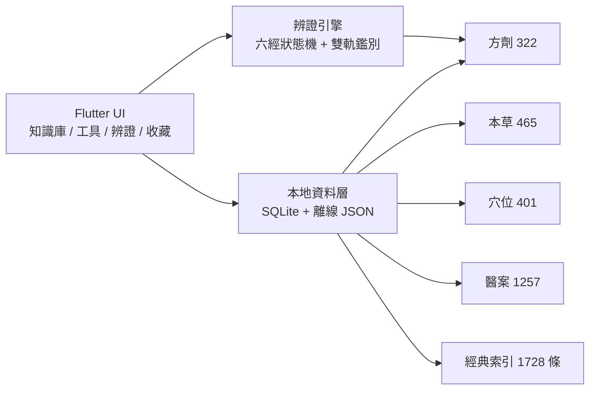

### 診斷引擎設計

**4 級方劑匹配策略：**
1. 精確匹配 `name`
2. 別名匹配 `alias`
3. 斜槓分割匹配（如"小柴胡湯/大柴胡湯"取第一個）
4. 子串匹配（如"桂枝加厚朴杏仁湯"匹配"桂枝湯"）

**口語增強匹配（V1.11.9 新增）：** 在上述基線字面匹配之上，疊加 `FormulaMatcher` 的口語語料加權命中——辨證指標 `indicators` 權重 0.4、患者口語 `oral` 權重 0.15，語料按「、」與句讀切分成片段後逐片段比對，並**過濾否定詞**（"無便秘"不計為"便秘"命中）。增強分上限 `enhancementCap = 0.9`，嚴格小於 1，從數學上保證**基線分更高者永遠排前**：新語料只負責撈回原本 0 命中的方劑、或在同分層內重排，絕不打亂原有正確排序。

**合病檢測：** 6 經評分 → 精確條件匹配 → 方劑覆蓋
**鑑別診斷：** 經 + 證型關鍵詞 + 問診答案 → 26 對鑑別
**六經公式分型：** 主證經 → 分型表（太陽：中風/傷寒/溫病；陽明：經熱/腑熱；少陰：寒化/熱化；厥陰：寒熱錯雜/血虛寒厥…），含脈象/治法/代表方/辨證要點。

---

## 📜 六經辨證體系

| 經 | 主證 | 主方 | 要點 |
|:---:|:---|:---|:---|
| **太陽** | 脈浮、頭項強痛、惡寒 | 桂枝湯 / 麻黃湯 | 表證第一關 |
| **陽明** | 但熱不寒、胃家實 | 白虎湯 / 承氣湯 | 陽明無死證 |
| **少陽** | 口苦咽乾目眩、往來寒熱 | 小柴胡湯 | 半表半里，但見一證便是 |
| **太陰** | 腹滿吐利、食不下 | 理中湯 / 四逆湯 | 脾虛寒溼 |
| **少陰** | 脈微細、但欲寐 | 四逆湯 / 真武湯 | 心腎陽虛，急溫之 |
| **厥陰** | 消渴、氣上撞心、寒熱錯雜 | 烏梅丸 / 當歸四逆湯 | 陰之盡，寒熱並結 |

---

## 🗺️ Roadmap

- [x] 六經辨證智慧診斷
- [x] 完整處方生成（組成+劑量+煎服法+禁忌）
- [x] 經方加減法（23 條規則）
- [x] 合病擴充（14 種覆蓋）
- [x] 鑑別診斷擴充（26 對場景）
- [x] 診斷歷史趨勢圖（六經傳變視覺化）
- [x] 方劑/藥物/穴位速查增強（搜尋+篩選）
- [x] 子午流注取穴計算器
- [x] 經方劑量換算器
- [x] 應用內更新檢測（GitHub Releases）
- [x] 黃帝內經模組（臟象/望診/脈診 + 73 篇閱讀庫 + 全文搜尋）
- [x] 附子生炮拆分（生附子/炮附子獨立條目，組成引用零死鏈）
- [x] 倪師醫案庫 1257 例檢索 + 閉門課重症臨床模組
- [x] 七步問診十問模組 v3.1（脈象/疼痛/嘔吐型別追問）
- [x] 健康人基線判定 + 寒熱真假八維法 + 六經公式分型（V1.11.8）
- [x] 患者口語語料接入：170 首方「患者會怎麼說」+ 現代症狀詞召回（V1.11.9）
- [x] APK 交由 GitHub Actions 自動構建釋出（V1.11.9）
- [ ] 舌診 AI 輔助（TFLite 本地模型）
- [ ] 脈診輔助（脈象分類）
- [ ] 方劑對比功能
- [ ] 匯出 PDF 診斷報告

---

## ❓ 常見問題解答（FAQ）

**Q1：App 需要聯網嗎？**
不需要。所有知識庫（方劑、本草、穴位、醫案、經典著作）均打包在本地，離線可用。預設僅「應用內檢測更新」會連網訪問 GitHub；可選的「問倪師AI」需自行配置端點後才會在主動提問時連網，預設關閉。

**Q2：我的診斷資料安全嗎？**
診斷歷史、收藏等資料全部儲存於本機 SQLite，不上傳任何伺服器，隱私不出裝置。

**Q3：應該下載哪個 APK？**
絕大多數現代手機選 **arm64-v8a**（38.0MB，體積較小）；拿不準就選 **通用版**（85.1MB，相容所有架構）；老舊 32 位裝置選 armeabi-v7a（35.7MB）；模擬器選 x86_64（39.6MB）。

**Q4：安裝時提示「應用未安裝」/「安裝失敗」怎麼辦？**
多半是**簽名不一致**或安裝包損壞導致的覆蓋安裝被拒。解決辦法：**先解除安裝舊版本，再安裝新版本**（解除安裝前記得在「設定」中匯出收藏與診斷歷史）；若仍失敗，改用通用版 APK 重試。

**Q5：紫微/易經/四柱模組是醫療功能嗎？**
不是。這些模組為**中國傳統民俗文化參考**，與經方醫療模組在介面與文案上明確分隔，不構成任何醫療診斷或建議。

**Q6：附子為什麼分"生附子"和"炮附子"？**
遵循倪海廈"生附子是生附子、炮附子是炮附子，不能取代"的嚴謹口徑，App 將其拆分為獨立條目，方劑組成 1663 處引用全部精確解析，避免誤用。

**Q7：醫案庫"治法/疾病"篩選是怎麼分類的？**
治法欄按醫案內實際出現的**經方方劑名**分類（取高頻前 12）；疾病欄按**西醫病名**分類（經約 150 個正名詞典簡繁歸一抽取）。篩選邏輯均經迴歸測試守護。

**Q8：辨證結果裡的「患者會怎麼說」是什麼？**
它是本 App 為 170 首經方補上的"口語畫像"——把《傷寒論》《金匱要略》的文言條文譯回病榻邊真實會說的大白話（如桂枝湯：「身上有點發燒，雖然一直微微出汗，但風一吹過來就覺得冷，特別怕風」），並一併給出辨證指標、核心治法與可回溯的原文條文。你可以逐句對照自核"這話像不像我說的"；對引擎而言，它同時充當兜底語料，讓"怕冷""怕風"這類現代症狀詞也能召回對應的古文方劑。

**Q9：如何參與貢獻？**
歡迎提交 Issue 與 Pull Request。詳見[貢獻指南](#️-貢獻指南)。

**Q10：「問倪師AI」要花錢嗎？會不會把我的病歷傳上去？**
不用花錢。智譜 `GLM-4.7-Flash`、書生 `Atria-Dawn`、Agnes `agnes-3.0-flash` 都是免費模型，
註冊拿一個 Key 填進設定即可（詳見 **[免費模型配置指南](docs/free_api_guide.md)**）。
隱私上，這個功能預設關閉、關閉時零連網；開啟後只在你主動提問時傳送「檢索到的講義片段 + 你的問題」，
不上傳病史或診斷紀錄，API Key 只存本機 SQLite。詳見 [🤖 問倪師AI](#user-content-ask-nishi-ai)。

---

## 🤝 貢獻指南

感謝你關注漢唐中醫！我們歡迎所有形式的高品質貢獻。

### 行為準則

請保持友善、專業、就事論事。討論聚焦經典還原與工程質量，尊重倪海廈學術體系的準確性。

### 程式碼規範

- 遵循 [Dart Style Guide](https://dart.dev/effective-dart/style) 與 `flutter_lints`；
- 提交前務必執行 `flutter analyze` 與 `flutter test`，確保 **0 error**；
- 關鍵辨證路徑、篩選邏輯、渲染布局的改動**必須**補充/更新迴歸測試；
- UI 功能圖示統一使用 **Material Icons**（唯一例外：八卦符 ☰☱☲☳☴☵☶☷ 為《周易》語義符號，予以保留）；
- 顏色一律透過 `lib/theme/app_colors.dart` 的語義 Token（`context.colors`）引用，禁止硬編碼；
- 版本號規則：以 `pubspec.yaml` 的 `version: X.Y.Z+N` 為單一來源，每次釋出自增 patch 與 build 號。

### 提交流程

1. Fork 本倉庫；
2. 建立特性分支：`git checkout -b feature/amazing-feature`；
3. 提交更改（遵循 Conventional Commits）：`git commit -m 'feat: add amazing feature'`；
4. 推送分支：`git push origin feature/amazing-feature`；
5. 建立 Pull Request，並在描述中說明：改動內容、測試結果、對相關辨證/資料的影響。

### 提交資訊規範（Conventional Commits）

| 字首 | 含義 |
|:---|:---|
| `feat:` | 新功能 |
| `fix:` | 缺陷修復 |
| `docs:` | 文件變更 |
| `refactor:` | 重構（無功能變化） |
| `test:` | 測試相關 |
| `chore:` | 構建/工具鏈 |

---

## 📄 開源許可

本專案以 **Apache License 2.0** 釋出。

- 許可證全文見 [LICENSE](LICENSE)；
- 你可以自由使用、修改、分發本軟體，包括商業用途，但須保留版權宣告與許可宣告，並遵循 Apache 2.0 的條款（含變更說明、通告檔案等要求）。

© 2026 jangviktor-web

---

## 📚 參考資料

| 來源 | 內容 |
|:---|:---|
| 倪海廈《人紀》 | 傷寒論、金匱要略、黃帝內經、針灸大成、神農本草經 |
| 張仲景《傷寒論》 | 六經辨證體系 |
| 張仲景《金匱要略》 | 雜病辨證 |
| 《神農本草經》 | 藥物性味歸經（448 種） |
| Wsy-prog/tcm-diagnosis-system（MIT） | 核心中醫辨證模組結構借鑑（v3.4），為六經辨證問診增強提供對照參考 |
| ziwei_core（Dart, MIT） | 紫微斗數 / 八字 / 命卦排盤引擎（純離線） |
| sxwnl_spa_dart（Dart） | 曆法 / 真太陽時 / 節氣計算（農曆 · 干支 · 節氣） |

> 本 App 借鑑並使用了上述開源專案，已按許可證要求標註出處，感謝原作者與社群。

---

## ⚠️ 免責宣告

本 App 為中醫經方**學習與輔助參考工具**，所有辨證結果、方劑建議均不可替代執業醫師的診斷與治療。用藥請遵醫囑，急重症請立即就醫。命理相關模組為民俗文化參考，與醫療無關。

---

## 🌟 Star History

[](https://repostars.dev/?repos=jangviktor-web%2Fnihaixia-app&theme=grape)

---

<div align="center">

**⭐ 如果這個專案對你有幫助，請給個 Star！**

</div>
